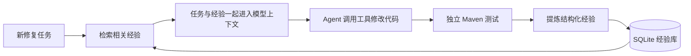

# 项目核心：经验驱动的修复闭环

项目主线是把一次成功修复沉淀为结构化知识，再让知识进入下一次修复。Agent 负责执行，工具负责读写和运行项目，独立测试提供反馈；经验模块负责提炼、存储、检索和注入，把不同任务连接起来。

## 结构化经验如何设计

公共模型位于 `backend/shared/models.py` 的 `ExperienceCreate` 与 `Experience`；数据库表见 `backend/experience/database.py`。

| 作用 | 字段 | 内容与用途 |
| --- | --- | --- |
| 查找 | `error_type` | 标准 Java 异常类名；当前用于精确匹配 |
| 查找 | `tags` | 技术与问题主题标签；当前 Agent 要求 `java` |
| 复用 | `task_summary` | 这条经验处理过什么任务 |
| 复用 | `root_cause` | 原实现为什么出错 |
| 复用 | `solution` | 可迁移的修复规则与方法 |
| 验证 | `verification` | 最终测试数量与验证工具调用 ID |
| 追溯 | `source_task_id` | 产生这条经验的任务 |
| 追溯 | `id` | 全流程一致的经验 UUID |
| 追溯 | `created_at` | 保存时间，参与新旧排序 |

Agent 成功结束且独立测试通过后，另调用一次模型，输入任务、修复总结、修改文件和执行结果，要求输出含 6 个知识字段的 JSON。程序将异常类型归一化，写入真实的 `verification`、绑定 `source_task_id`，并补上 `java` 标签。Pydantic 校验结构和长度；存储层生成 `id`、`created_at` 后写入 SQLite。

根因和方案分开保存，分别回答“为什么错”和“怎样改”。例如库存经验的根因是“先修改源仓，后续容量检查才失败”，方案是“先完成全部校验，再修改两边状态”。这条规则可以迁移到积分转赠。

## 保存后怎样使用

1. 从新任务描述中提取异常类名；中文“空指针”也可映射为 `NullPointerException`。
2. 调用 `search_experiences("", tags=["java"], error_type=error_type, limit=5)`。存储层按标签和异常类型筛选，按创建时间、ID 降序返回。
3. 把命中的完整经验对象序列化到 `messages[1].content` 的 `reference_experiences`，与 `task`、`max_decisions` 一起发送给模型。
4. 模型根据当前代码、测试和参考经验生成工具调用；之后的工具结果继续追加进同一轮任务上下文。
5. 新修复通过最终测试后，生成并保存新的经验记录，下一次检索就能使用它。

目前的 Agent 检索入口使用标签和异常类型。经验存储接口还支持关键词查询；当前执行循环传入的关键词为空。代码对应 `backend/agent/core.py`、`backend/experience/store.py`。

## 本次真实复用链

已有库存经验 `3a1fc9e4-9bc1-463d-a9b5-501604e7f9bc` 的类型为 `IllegalArgumentException`。积分转赠新任务用同一异常类型和 Java 标签检索，从两条旧记录中命中这一条；订单经验的类型为 `AssertionFailedError`，未命中。

录制器截取了交给真实 ChatClient 的任务及经验正文，并与成功请求审计中的 ID、SHA-256 对应。积分任务的成功请求包含这条库存经验；修复后 12 项测试全部通过，新增经验 `ed6bd4f5-0423-487f-a96d-78f65d809bd8`，本次工作库从 2 条增至 3 条。

默认演示入口为 `docs/demo/recorded-demo.html` 的“项目核心 · 经验怎么复用”，五幕依次展示字段设计、检索匹配、请求注入、新代码和经验增长。点击字段可看设计用途和该条记录的原文。

## 汇报时的一句话

**我们把 Agent 的成功修复过程整理成可验证、可检索的经验，让后续任务能够读取并复用这些修复知识，形成持续积累的闭环。**
