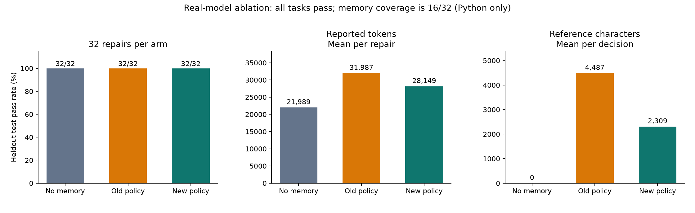
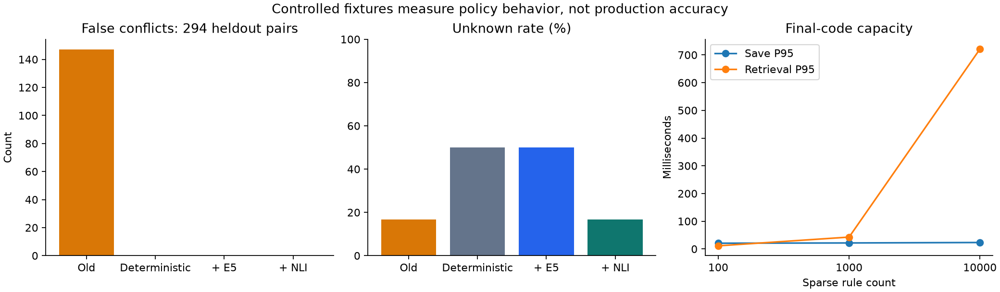

# 自动经验整理优化：实验报告（2026-11-14）

**真实评估三组均为 32/32 通过，没有测出修复成功率提升。** 新策略相较旧策略平均已报告 token 减少 12.0%，实际决策中的引用 JSON 长度减少 48.5%。结果支持引用压缩和处理安全性的改进，不能据此宣称能提升复杂项目的修复率。

## 真实修复实验

使用已配置的 deepseek-flash，12 个训练任务和 96 个评估任务，总计 108 次，不重跑整项任务。每项上限 20 轮/600 秒，3 个工作线程；Java/Python 各 4 个评估项目，每个项目在三种策略下各重复 4 次。修复器、工具、任务和测试相同；提供商随机性未强制设种子。

| 指标 | 无经验 | 旧策略 | 新策略 |
|---|---:|---:|---:|
| 原始及保留测试通过 | 32/32 | 32/32 | 32/32 |
| 有实际经验引用的任务 | 0/32 | 16/32 | 16/32 |
| 平均已报告 token | 21,989 | 31,987 | 28,149 |
| 平均决策轮数 | 5.25 | 5.09 | 5.34 |
| 平均总耗时（秒） | 50.76 | 48.25 | 49.92 |
| 平均引用字符/决策 | 0 | 4,487 | 2,309 |

全部 108 次共报告 2,917,710 tokens。评估请求的用量返回覆盖为：无经验 197/200、旧策略 192/195、新策略 201/203。表格只汇总实际返回的用量，缺失请求未估算，因此不是完整账单；12.0% 是观察到的差值，置信区间包含 0，尚不能确认稳定节省。
32/32 的按运行计数 Wilson 95% 区间为 89.3%–100.0%；同项目重复并非独立任务，这个区间不能外推生产分布。按 8 个项目簇重采样的配对 token 差（新减旧）为 -3,838，探索性 95% 区间 [-8,818, 844]。并发执行、外部服务负载及输出随机性使耗时不适合当成严格提速证据。

训练阶段 12/12 修复通过，但仅 8 个任务成功保存、共 9 条经验。4 个 Java 提取因未核对的符号格式被拒绝；此问题已修复并单独回归，实验保留原始覆盖缺口，没有补造训练数据。两种记忆策略都只有 Python 的 16 个评估任务实际收到引用；Java 的缺失训练覆盖与精确异常类型筛选导致 0/16 命中。因此不能将总体 token 差当成 Java 复用效果。

20 个项目的原始失败基线均已独立验证。保留测试位于工作区之外，修复后才复制到独立验证项目执行；它们覆盖额外输入，但与原始测试共享契约模板，不代表任意隐藏业务需求。原项目哈希和两个冻结数据库哈希均保持不变；评估输出写入另一个库。

## 语义消融与补充反例

600 对规则由明确契约生成，开发集 306 对使用英文模板，保留集 294 对使用不同的中文模板。仅 6 个基础语义模板、变量名变体较多；数字并非独立自然语料样本。

| 保留集指标 | 旧策略 | 确定性 | 确定性 + E5 | 加双向 NLI |
|---|---:|---:|---:|---:|
| 分类准确率 | 50.0% | 66.7% | 66.7% | 100.0% |
| unknown 比例 | 16.7% | 50.0% | 50.0% | 16.7% |
| 误合并 | 0 | 0 | 0 | 0 |
| 误报冲突 | 147 | 0 | 0 | 0 |
| 漏识别冲突 | 0 | 49 | 49 | 0 |

E5 改变召回排名，不改变确定性关系判定，因此这两组关系指标相同。独立的 100 个同义查询对 200 个候选：Recall@1=84%，Recall@5/10=100%；代码事实检查不会被相似度绕过。
NLI 的保留集等价 98/98、冲突 49/49 的按样本 Wilson 下界分别为 96.2% 和 92.7%，不是“生产准确率至少 99%”的证据。阈值仅在开发集选择，保留集与额外挑战集作为启用门槛。

额外 16 对手工契约反例发现两次高分误合并：`x >= 10` 与 `x > 10`（0.993），`x == 0` 与 `x != 0`（0.970）。加入操作数、比较运算符与布尔连接保护后，误合并 2→0、误报冲突仍为 0；unknown 8→10，7 个真实冲突只识别 3 个，其余 4 个待审阅。修复前报告保留，没有通过删除难例或只报告精度隐藏漏检。

## 最终代码、故障与容量

最终版本独立重跑 40/40 组流程，覆盖重复、61 条密集组、版本、路径大小写、限制保留、局部暂停、依赖和撤销。事务、过期租约、并发决定、旧记录及 Hypothesis 状态序列另由回归测试覆盖。

| 经验数 | 保存 P95/ms | 整理秒 | 检索 P95/ms | 数据库 MiB | 原始/规则/证据 |
|---:|---:|---:|---:|---:|---|
| 100 | 20.7 | 2.3 | 11.3 | 0.80 | 100/100/100 |
| 1,000 | 21.7 | 28.1 | 42.8 | 4.59 | 1000/1000/1000 |
| 10,000 | 23.3 | 534.3 | 721.0 | 43.04 | 10000/10000/10000 |

所有容量作业最终完成，integrity_check 均为 ok。容量样本为互不重叠文件，未运行 NLI；密集同域仍可能平方级比较。机器为 Windows、Python 3.13.7、SQLite 3.50.4，默认回滚日志；详细包版本见 metrics.json。

最终代码对实际新策略的 32 项任务、204 次查询重放，引用完全一致 204 次。重放不调用修复模型；以最终源码快照、真实训练库和独立请求审计为依据。最初实验工具的可变 error_types 引用已改为深复制，历史重放采用 Agent 当时记录的逐调用快照。

最终回归：后端 613 项通过、1 项跳过；前端 131 项通过，生产构建通过；接口集成检查通过，V3 端到端验收 13 项任务通过。后两项采用脚本化模型，不计入 108 次真实模型实验。

## 复现与原始产物

- [中文效果总览](effect-overview-zh.png)；[API 来源复核与后续配置修复](api-configuration-audit.md)。历史调用未记录逐请求凭据指纹，来源复核不冒充历史请求证据。
- 汇总数据：[metrics.json](metrics.json)；108 项精简结果：[trials.json](trials.json)。图表同时提供 SVG。
- 完整真实记录：`.cache/knowledge-live-experiment/`；冻结旧代码及两个数据库均保留。
- 语义样本及分数：`.cache/knowledge-semantic-experiment/`；补充反例：`.cache/knowledge-adversarial-experiment/`。
- 最终代码快照、容量库及重放：`.cache/knowledge-release-validation/`，源快照 SHA-256 记录在 metrics.json。
- 命令和官方依据见 [修复记录](../../experience-consolidation-remediation.md) 与 [使用说明](../../experience-consolidation.md)。

结论限于这些数据：错误冲突与边界误合并得到抑制，证据和来源不再链式复制，后台故障可恢复且审阅可撤销；真实任务未测出成功率提升，记忆覆盖、语义漏检和密集场景成本仍须继续观察。
