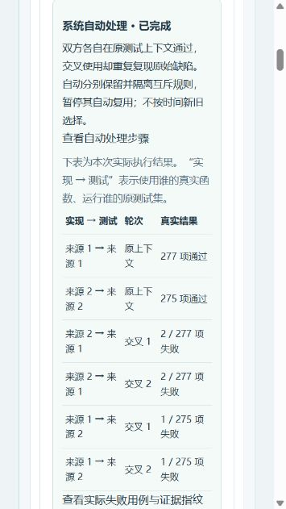
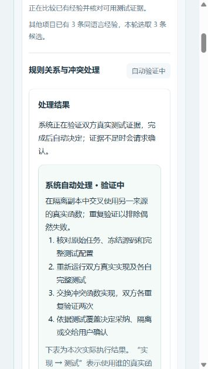

# 普通上传修复后的真实测试自动冲突裁决

2026-11-15，本轮完成了正常上传、真实模型修复、经验提取、冲突发现、独立复核、六轮真实交叉测试和系统自动保存决定。最终结果为 **分别保留并隔离**，决策执行者是 `system`。本轮没有调用人工解决冲突接口或点击采纳按钮。

直接查看：[正常经验记录页](http://127.0.0.1:5173/#/experiences?id=14e95e0b-29b3-4ab1-8a91-085e7333ad19)。打开的第一条冲突记录显示原文、处理前后状态、六次测试和“系统自动保存决定”。

## 实际工程来源与运行范围

新上传的是 [pytest #10356](https://github.com/pytest-dev/pytest/pull/10356) / [#7792](https://github.com/pytest-dev/pytest/issues/7792) 的真实缺陷源码：多继承的类标记丢失，需要汇总各类的本地标记。使用上游提交 `680f3e2097712a067f08881f0e6c3c4b35cfbc61` 的完整源码，并应用该 PR 的官方回归测试补丁。该版本是先前研究基线的直接父提交，仍具有同一原始缺陷；重新上传是为了产生独立的新任务，保留先前人工审阅的历史。

准备过程只追加官方测试、构建所需版本文件、精确依赖清单和普通上传说明，没有提供官方生产修复补丁，没有注入经验或修改正式数据库。准备时发现 Git 在外层仓库的忽略目录中跳过了测试补丁；修正隔离仓库上下文后重新打包并验证，原始工程稳定呈现 **274 通过、1 失败**。只有这个已复现缺陷的包被正式上传。

对比来源是之前正常上传并真实修复的 [pytest #10447](https://github.com/pytest-dev/pytest/pull/10447)：父类 fixture 必须先于子类 fixture 执行。它要求 `get_unpacked_marks` 使用 `reversed(obj.__mro__)`。#10356 的官方测试要求 `C、A、B`，#10447 的官方测试要求 `B、A、C`，并增加了 fixture 顺序回归。两套测试确实规定不同的行为。

| 项目 | 本次独立修复 #10356 | 既有真实修复 #10447 |
|---|---|---|
| 任务 | `9f9701f9-d149-4a43-9b75-431ebaa71c5f` | `b176ff8f-4044-4118-a666-150f62a77df2` |
| 经验 | `14e95e0b-29b3-4ab1-8a91-085e7333ad19` | `9977f923-1736-4de7-ac0b-dea4a8e70001` |
| 冻结的完整登记测试 | 275 项 | 277 项 |
| 已验收实现 | 按 `obj.__mro__`，子类优先 | 按 `reversed(obj.__mro__)`，基类优先 |

“完整登记测试”指上传时冻结的测试配置，并非 pytest 仓库全部测试：包括 `testing/test_mark.py`、`testing/test_skipping.py`、`testing/python/collect.py` 和 `TestFixtureUsages`。仅排除上游已有的 xfail `test_keyword_extra_dash`，并未排除本次真实失败；具体配置见[上传清单](automatic-conflict-evidence/upload-manifest.json)。

## 正常修复与真实模型调用

使用普通 `/api/projects/upload`、项目配置和 `/api/tasks` 接口。模型配置来源始终是 `D:\中级实训\self-evolving-coding-agent\.env`，`https://api.deepseek.com` / `deepseek-flash`，直连；未使用另一个项目的配置。

修复于北京时间 20:42:26 开始，20:45:50 结束。实际测试过程为：1 项失败 → 第一次修改后仍 1 项失败 → 275 项全通过 → 程序独立最终验收再次 275 项全通过。唯一变更文件为 `src/_pytest/mark/structures.py`；模型同时修复标记读取和 `store_mark` 的本地标记写回。

共 **19 次真实模型请求**：14 次决策、1 次经验提取、1 次共同原则归纳、1 次归纳复核、1 次冲突发现、1 次冲突复核。六次后续证据验证不调用模型，也不让模型重写测试或候选实现。请求审计、原始工具结果与最终补丁分别见[调用审计](automatic-conflict-evidence/repair-audit-safe.json)、[任务步骤](automatic-conflict-evidence/steps.json)、[生产修复](automatic-conflict-evidence/repair.diff)。

## 系统实际执行的六轮测试

验证于 20:47:55 开始，20:51:20 自动保存决定。程序从双方最终冻结快照取得真实函数体，用标准库 AST 核对接口、依赖和范围，在六个独立副本中执行原配置。双方原始工作区和测试文件均未改变。

| 使用的真实实现 | 运行的冻结测试 | 轮次 | 实际结果 |
|---|---|---|---|
| #10447 基类优先 | #10447 | 原上下文 | **277 / 277 通过** |
| #10356 子类优先 | #10356 | 原上下文 | **275 / 275 通过** |
| #10356 子类优先 | #10447 | 交叉 1 | **2 / 277 失败** |
| #10356 子类优先 | #10447 | 交叉 2 | **2 / 277 失败** |
| #10447 基类优先 | #10356 | 交叉 1 | **1 / 275 失败** |
| #10447 基类优先 | #10356 | 交叉 2 | **1 / 275 失败** |

#10447 的两个失败是 `testing.test_mark.test_mark_mro` 与 `testing.test_mark.test_mark_fixture_order_mro`；#10356 的失败是 `testing.test_mark.test_mark_mro`。每个方向两次失败集合相同，测试集合和测试数与该方向原上下文一致，均无错误或跳过，而且每个失败都对应目标任务的原始缺陷用例。交叉测试中的失败是裁决证据，并非最终修复任务失败。

因此不存在能满足双方已登记测试的唯一实现。系统按 `verified-cross-tests-v1` 自动选择 `keep_separate`，而非按新旧顺序采纳其中一个。这是不同上下文的行为冲突得到自动隔离，不是证明某个上游版本错误，也没有把相反规则硬合成一条。

## 前后变化与完整性核对

- 自动决定 `47b041f9-73d5-5adb-9d61-8ff95bf7d990`：版本 1 待处理 → 版本 2 已处理；仅有一条决定历史，`actor=system`。
- 本次经验 3 条规则中的排序规则暂停，其他 2 条继续有效；#10447 的直接排序规则暂停，其他 1 条保留。原始经验正文和真实修复结果都保留。
- 另一条关联冲突因同一本次排序规则已隔离而变为“来源已停用”，未重复付费修复或手工决定。
- 本轮还对 Sphinx 历史经验进行了正常共同原则归纳与复核；该历史归纳在相关来源隔离后显示“合并已暂停”，没有继续当作有效公共规则复用。
- 先前两条人工冲突关系的数据库记录逐字段保持不变；未撤销旧决定来制造新冲突。
- 独立只读核对六个执行产物的 SHA-256、全部原始工作区清单、两套测试集合和交叉副本差异。交叉副本只变更冲突函数所在生产文件，原上下文副本没有源码差异。
- 服务空闲后恢复临时超时设置并重启；经验、自动决定和六次证据保持一致，模型请求总数仍为 19，没有重复裁决。

证据指纹：`604364bfbabad998499c9d541602878a64a366348dd70df6ff133a6e388717a0`。

[自动决定原始证据](automatic-conflict-evidence/automatic-review.json) · [决定历史](automatic-conflict-evidence/automatic-history.json) · [独立完整性核对](automatic-conflict-evidence/independent-proof-check.json) · [实际状态变化](automatic-conflict-evidence/observed-transitions.jsonl) · [处理前](automatic-conflict-evidence/snapshot-before-auto.json) · [处理后](automatic-conflict-evidence/snapshot-after-auto.json)。目录同时保存六份真实工具输出、六份 JUnit XML 和四份实际交叉替换差异。

## 实现覆盖与边界

后端 **711 passed、1 skipped**；前端 **146 passed**，类型检查与生产构建通过。独立临时项目的集成检查真实执行 pytest，验证唯一胜者自动采纳、互斥上下文自动隔离、测试无法区分时转人工、快照变化、非原始失败、测试不稳定和并发人工决定保护。这些自动化检查使用受控提取/分类响应，与上述正式库的真实模型运行分开。

当前自动移植范围是可定位、接口兼容的 Python 函数；其他语言、不可核对依赖、缺少冻结快照、测试无法区分、环境异常或中断时保留证据并请求用户确认。页面在验证过程中隐藏选择表单，在证据不足时恢复确认。两次重复不能完全排除偶发测试，测试通过也不能证明所有未覆盖行为正确；自动隔离暂停冲突规则的复用，尚不生成可按业务条件自动切换的版本规则。

具体改动和官方技术依据见 [R41–R44 修复记录](../../experience-consolidation-remediation.md#r41r44测试证据驱动的自动冲突处理)。

