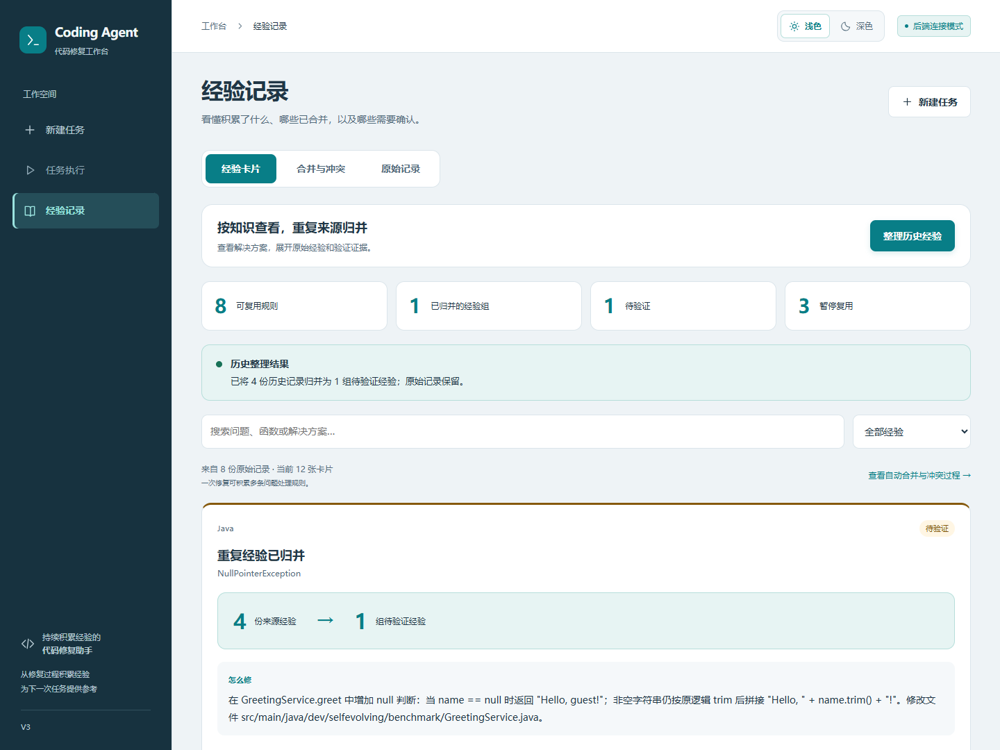
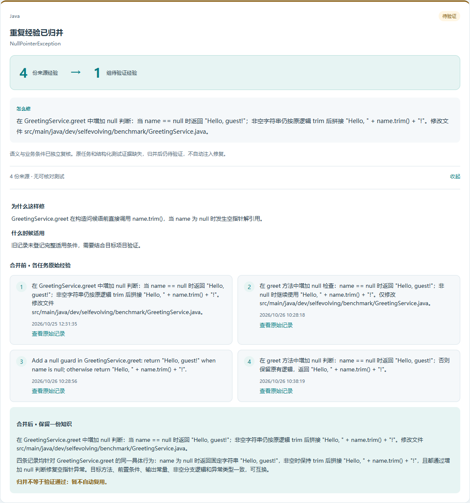

# 经验库改版与历史整理实录

日期：2026-11-15。所有页面截图和本节历史归并结果均来自本机正式经验库，不使用模拟数据。

## 用户可直接看到的变化

打开 [正常经验记录页](http://127.0.0.1:5173/#/experiences)，默认是经验卡片。卡片先展示解决方案、状态和来源数量，展开可看原因、适用条件、合并前各任务原文以及合并后的结果。

- **经验卡片**：按知识查看；重复来源归在同一张卡片内，有效的跨项目共同原则也在这里显示。
- **合并与冲突**：按“来源 → 比较/验证 → 结果”展示自动处理，保留之前真实工程的六轮测试和系统决定。
- **原始记录**：完整来源保留，可从卡片直接跳转；不会将原始记录的存在误报为未合并。

## 为什么之前的重复经验没有合并

原自动比较队列只在新保存合格经验时登记任务，既存旧记录没有补扫。另一个问题是原页面以原始记录为主要视图，即使已有规范规则，来源仍会分别列出。

正式库有 8 份原始经验，其中 4 份是旧 GreetingService 修复笔记。这些笔记没有结构化证据，原任务也不在任务表中；原文字段提及 Maven 通过不能证明对应工具调用现在仍可核对。直接合并并标为可复用会错误提高可信度。

现在的“整理历史经验”会将历史合格来源补入原来的正常自动比较队列。旧笔记则采用两阶段模型比较：先提出具体行为等价的候选组，再独立复核每一条与代表笔记是否等价。程序核对逐字引文、来源集合、共同业务条件、语言和版本范围。只采用原有代表方案，归为待验证经验组，保留所有原始记录。

这使用现有 SQLite 事务、Pydantic 严格模型、后台队列和 Vue 视图；没有新建指定项目的演示入口。扫描具有持久化状态、租约心跳、源指纹检查及重复提交保护。失败必须显式重试，原失败审计保留；页面读取本身不调用模型。

## 本次真实整理结果

| 项目 | 结果 |
|---|---|
| API 配置来源 | `D:\中级实训\self-evolving-coding-agent\.env` |
| 模型 | `deepseek-flash`，`https://api.deepseek.com`，direct |
| 扫描 ID | `3e07f801-b668-46b4-9057-9d8038d88408` |
| 执行时间 | 2026-11-15 21:11:20–21:11:44，北京时间 |
| 真实模型请求 | 2 次：`history_grouping`、`history_grouping_review` |
| 输入 | 正式库既存的 4 份 GreetingService 笔记，包含中英文不同措辞 |
| 输出 | 1 组待验证经验，0 份可核对测试证据 |
| 原始记录 | 前后均为 8 份，逐字段比较一致 |
| 经验卡片 | 15 → 12；4 张旧笔记卡片合为 1 张 |
| 当前状态 | 8 条可复用、3 条暂停复用、1 组待验证 |
| 重启与重复提交 | 结果保留，复用同一扫描，请求总数仍为 2；4 条原有冲突关系未变 |

同一修复可提取多条问题处理规则，所以卡片数不等于原始记录数。已归并数是上述状态的交集，不能与状态数量相加。

4 份笔记的共同含义是：`GreetingService.greet` 对 `name == null` 返回固定访客问候；非空输入继续按原有 `trim()` 逻辑构建问候，不改变既有输出合同。模型独立复核逐条确认了这些条件。选取的合并后方案来自已有记录，没有生成新的补丁或伪造测试。

**这次运行是补齐正式库旧重复笔记的归档整理，不是新的复杂工程修复实验。** 原 pytest/Sphinx 工程的真实修复和证据裁决继续保留于 [自动证据裁决实录](automatic-conflict-flow.md)。旧笔记缺少测试证据，所以归并后仍不能自动注入修复。

## 验证与证据

- 后端全量：717 passed、1 skipped。此后针对新增批次推进、失败显式重试、共同原则卡片检查，相关 19 项通过；最终历史模块 8 项通过。
- 前端：149 项通过；TypeScript 检查和 Vite 生产构建通过。
- 浏览器：通过真实 HTTP 后端连接，用 Edge/Playwright 检查 1440×1080 桌面与 390×844 手机布局、搜索框宽度、4→1 原文对比、8 条原始记录分页、来源跳转、已有自动冲突流程和控制台错误；全部通过，无横向溢出和页面脚本错误。截图使用 [Playwright 官方截图接口](https://playwright.dev/docs/screenshots)。
- 后端重启后逐项比较扫描、归并组、原始记录和冲突关系。再次 POST 正常历史整理接口复用同一结果，没有新增付费请求。运行时超时恢复为任务 600 秒、模型 60 秒；未改写项目 `.env`。

可复核文件：

- [模型调用来源](experience-library-evidence/api-identity.json)、[两阶段模型审计](experience-library-evidence/history-audit.json)。
- [整理前视图](experience-library-evidence/library-before.json)、[整理后视图](experience-library-evidence/library-current.json)、[原始记录基线](experience-library-evidence/originals-before.json)。
- [重启与重复提交验证](experience-library-evidence/restart-verification.json)、[浏览器检查](experience-library-evidence/browser-check.json)。
- [后端全量结果](experience-library-evidence/backend-tests.log)、[历史模块最终结果](experience-library-evidence/library-tests-final.log)、[前端测试](experience-library-evidence/frontend-tests.log)、[生产构建](experience-library-evidence/frontend-build.log)。
- [手机页面](experience-library-evidence/experience-library-mobile.png)、[正常冲突流程页面](experience-library-evidence/conflict-journey-desktop.png)。

## 当前边界

历史笔记每次最多比较 10 份。页面显示剩余数量，可继续整理；跨批次同义关系仍可能漏检。本轮实际只有 4 份候选，因此全部进入同一批次。无结论或独立复核不通过时分别保留；不根据主题相近就强行合并。源记录变化会使已有归档分组失效，下一次整理使用新的源指纹。

历史归档不能补回失去的原任务或测试证据。正常上传修复仍按原流程验收、提取、自动比较、发现冲突并执行适用的测试验证；证据不足时继续请求用户确认。
