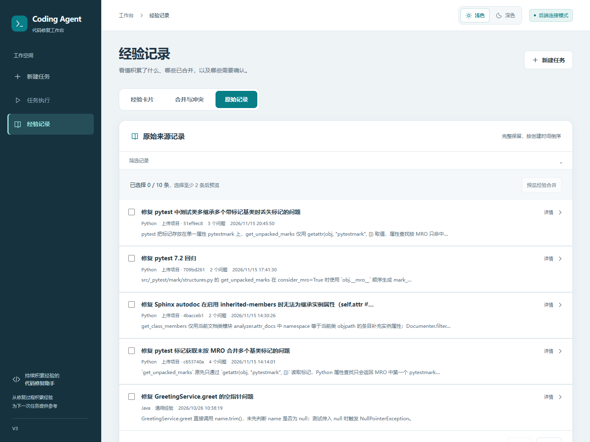
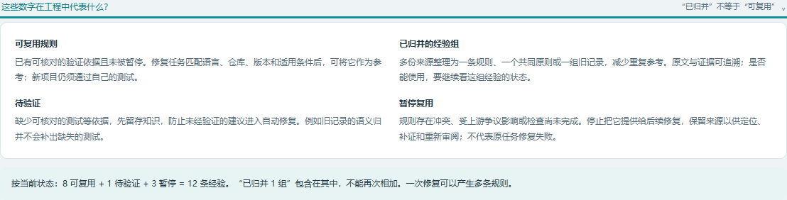
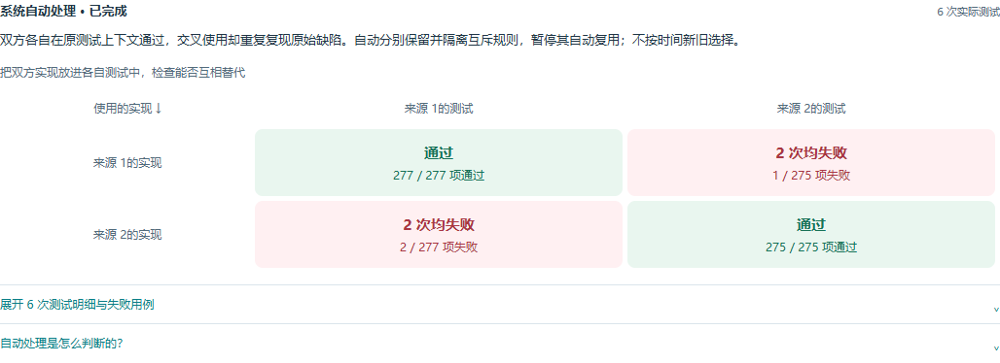

# 经验呈现优化与指标说明

2026-11-15，根据用户三张截图调整正常经验记录页。此次验收使用正式库现有经验和真实冲突测试记录。

## 阅读顺序

原页面把任务长描述、重复结论、完整方案及六轮测试同时展开。现在先展示解决方案和处理结论，再按需查看证据。

| 区域 | 调整后 |
|---|---|
| 原始记录 | 短标题 + 来源/时间 + 一行原因；复选框并入记录行，完整描述、全部标签、仓库 ID 和证据保留在详情 |
| 经验卡片 | 标题提取方案首句，区分同一函数的不同经验；合并数量用紧凑标记展示，点击可看左右前后对照 |
| 冲突结果 | 先显示隔离/采纳/待确认，再用四格表比较双方实现；双方方案并排，长原文和审计折叠 |
| 测试证据 | 四格表汇总两个实现与两个测试环境；六次执行、失败用例和证据指纹完整保留，展开后查看 |
| 统计区 | 每个数字配一句工程用途；可展开解释计数关系及复用条件 |

内容缩短采用原文摘录，不调用模型改写。长段落有“展开原文”，完整任务可从详情查看。摘要有省略号时仅表示显示节选，不能代替完整条件审阅。

## 四个数字的含义

| 当前值 | 含义 | 在工程中的作用 |
|---|---|---|
| 8 可复用规则 | 具备验证依据，且当前未被暂停 | 语言、仓库、版本、业务条件等匹配后，可为后续修复提供参考。通用经验还需符合发布与能力要求，目标项目仍须运行自己的测试 |
| 1 已归并的经验组 | 多份来源归为一条规则、共同原则或历史记录组 | 减少重复知识，保留原始来源以供追溯。当前这一组是 4 份 GreetingService 旧笔记，状态仍为待验证 |
| 1 待验证 | 尚缺可核对的测试等依据 | 保存可能有用的知识，同时阻止它未经验证就被自动复用。语义一致不能替代测试 |
| 3 暂停复用 | 相关规则存在冲突、依赖争议规则或尚未完成检查 | 暂停向后续修复提供这些规则，避免错误迁移；原始修复、测试及其他有效规则仍保留 |

**当前状态合计：8 + 1 + 3 = 12 张经验卡片。已归并的 1 组包含在其中，不能再加一次。** 原始来源有 8 份，一次修复可产生多条问题规则，所以来源数与卡片数不同。

## 四格表怎么读

“实现”是修复后的冲突函数，“测试”是某个来源工程登记的原测试集。每一行选择一个实现，列表示放入哪个来源的测试环境。

本次现有真实记录中：

- 来源 1 的实现通过自身 277 项测试，放进来源 2 环境则两次均失败 1/275 项。
- 来源 2 的实现通过自身 275 项测试，放进来源 1 环境则两次均失败 2/277 项。
- 系统据此分别保留并隔离相关规则，暂停自动复用。两种修复各自有证据，但不能直接互换；这不等于某个来源的修复失败。

界面只在相同方向的执行结果、数量、测试集合与失败用例一致时显示“2 次均失败/通过”；不一致时显示“结果不一致”，没有执行时显示“尚无结果”。六次执行没有被删除，也不把两次测试数量相加冒充更大的测试覆盖。自动决定仍由原后端证据流程执行，界面汇总不产生新的裁决。

## 验收

- 前端 152 项测试通过；TypeScript 与生产构建通过。
- 真实 HTTP 后端验收：桌面 1440×1080、手机 390×844、浅色和深色、键盘展开、完整原文、指标解释、四格表与六轮明细。
- 桌面当前页 5 条原始记录高度约为 112、113、113、113、112 像素；无横向溢出，页面脚本错误为零，浏览器 API 写请求为零。
- 只读比较确认原来的 8 份经验、1 个历史归并组和 4 条冲突关系保持一致，历史整理请求仍为 2 次。此次界面验收没有重跑模型修复实验。

参考：[MDN 原生折叠组件](https://developer.mozilla.org/en-US/docs/Web/HTML/Reference/Elements/details) 提供内容展开机制；测试表按 [W3C 行列表头指南](https://www.w3.org/WAI/tutorials/tables/two-headers/) 标注 caption 与 scope。沿用已有 Vue、CSS 主题和 Playwright 验收工具，没有新增产品依赖。

证据：[浏览器检查](experience-presentation-evidence/browser-check.json)、[数据核对](experience-presentation-evidence/data-verification.json)、[前端回归](experience-presentation-evidence/frontend-tests.log)、[构建记录](experience-presentation-evidence/frontend-build.log)。

其他截图：[新版经验卡片](experience-presentation-evidence/overview-desktop.png)、[合并前后](experience-presentation-evidence/merge-comparison.png)、[完整冲突区](experience-presentation-evidence/conflict-desktop.png)、[深色模式](experience-presentation-evidence/conflict-dark.png)、[手机概览](experience-presentation-evidence/overview-mobile.png)、[手机冲突表](experience-presentation-evidence/conflict-mobile.png)、[手机原始记录](experience-presentation-evidence/originals-mobile.png)。
