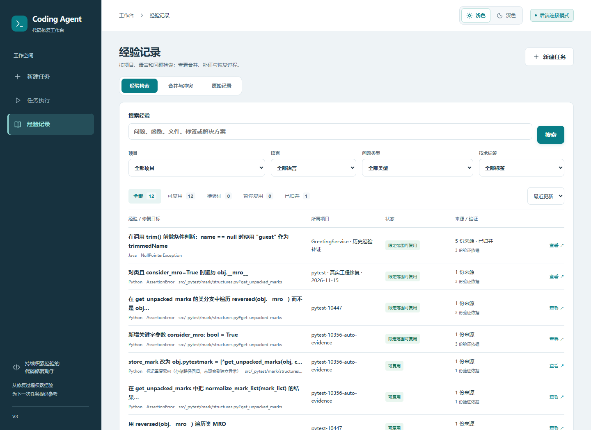
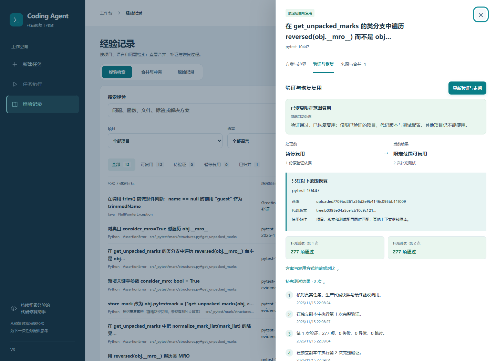
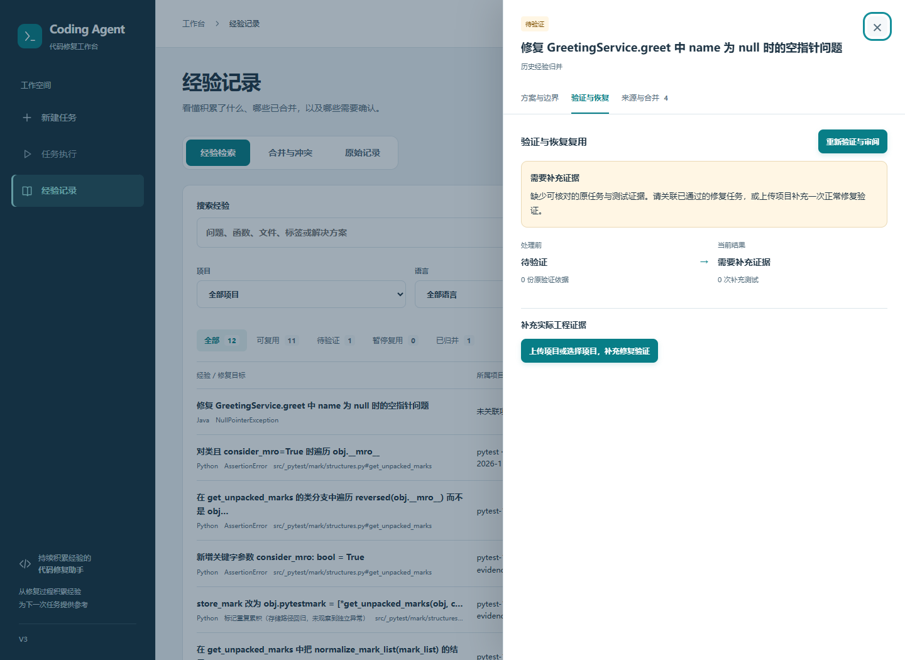
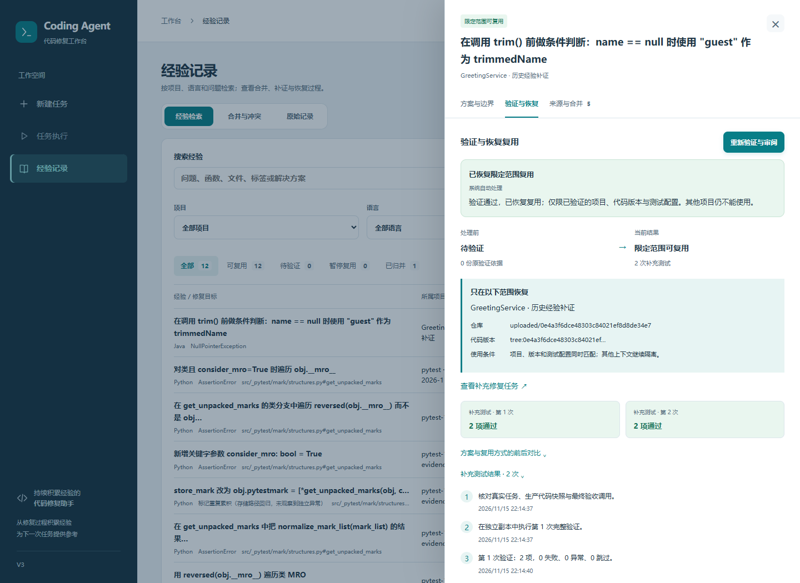
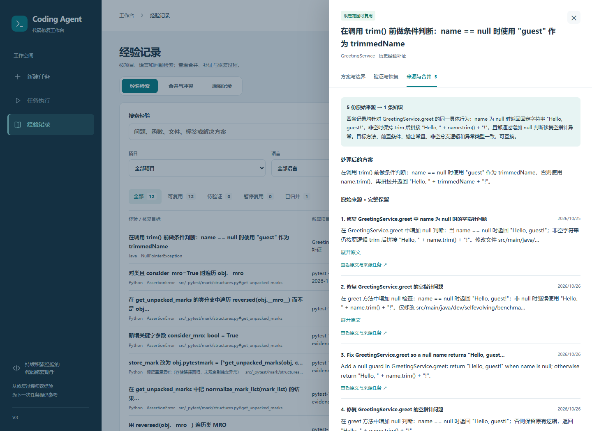
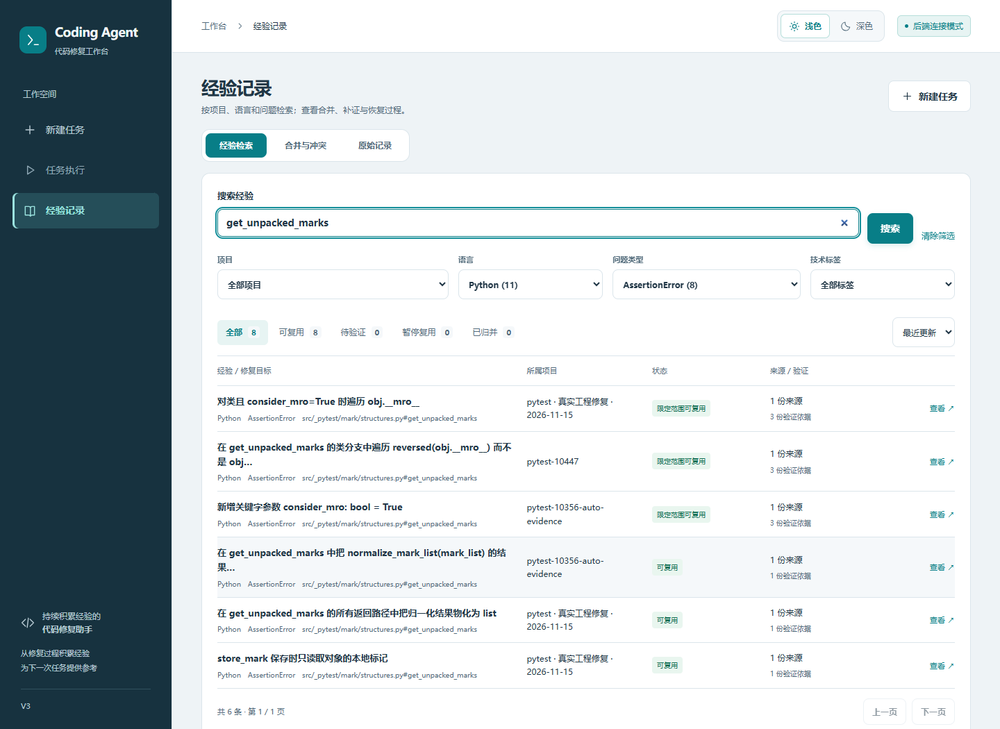

# 经验恢复复用与分类检索：正式数据运行记录

2026-11-15。使用现有经验库，通过普通经验接口与正常项目修复页面完成补证，没有演示入口、模拟生产记录或人工选定结果。

## 结果

| 指标 | 处理前 | 处理后 |
|---|---:|---:|
| 可复用知识 | 8 | 12，其中 4 条限于已验证范围 |
| 待验证经验组 | 1 | 0 |
| 暂停复用知识 | 3 | 0 |
| 已归并经验组 | 1 | 1 |
| 知识目录总数 | 12 | 12 |
| 原始来源记录 | 8 | 9，新增一份正常修复记录 |

“已归并”是知识目录的子集，不能加到状态总数上。逐字段比较确认原来的 8 份来源、4 条冲突关系均未改变。4 次恢复的处理者全部为 `system`，没有执行人工确认或冲突改判请求。

## 三条暂停规则：真实完整测试后恢复限定范围

| 原来源项目 | 第一次补验 | 第二次补验 | 结果 |
|---|---:|---:|---|
| pytest-10356-auto-evidence | 275 项通过 | 275 项通过 | 自动恢复到该仓库、代码版本、测试配置 |
| pytest-10447 | 277 项通过 | 277 项通过 | 自动恢复到该仓库、代码版本、测试配置 |
| pytest · 真实工程修复 · 2026-11-15 | 302 项通过 | 302 项通过 | 自动恢复到该仓库、代码版本、测试配置 |

六轮执行均零失败、零异常、零跳过。同一来源的两轮测试集合一致，与其原任务的完整验收数量一致。使用保留的真实修复副本和原测试配置，不让模型重写测试来迎合结论。

这些结果证明原修复在自己的上下文仍然成立，并没有推翻之前“跨上下文使用会失败”的冲突结论。系统保存单独的限定范围授权，旧冲突决定仍在。页面状态恢复后，实际送给修复模型的参考也受同样的边界约束。

恢复任务 ID：

- `50f59a88-59ab-4465-b323-2242e7d4eea7`：275 项 × 2。
- `c117c5e9-adf3-4a82-85a2-641a33d63111`：277 项 × 2。
- `26424412-0b5b-4f94-9228-275891c34faa`：302 项 × 2。

## 一组历史经验：正常上传修复补足缺失证据

旧 GreetingService 组有 4 份笔记，但缺少可追溯的原始任务和结构化测试。首次补证正确停在“需要补充证据”，没有把笔记里的“测试通过”当成真实验收。

从经验详情进入正常修复页面，导入原始 GreetingService ZIP，再使用这份已登记上传项目提交关联补证的修复任务。上传和提交均通过正常页面完成。

- 上传项目：`upload-dc84bb1f-1518-4591-8d7a-afbecca460be`。
- 正常任务：`8245146c-c149-4a75-9c66-088bddb8c6c6`。
- 关联补证：`264b373d-6655-450b-a374-02898bbada81`。
- 新经验：`eb25e957-055b-47ad-b8cf-3a21fc8f1d68`。

真实任务先运行 Maven，2 项中 1 项通过、1 项出现空指针异常。模型修改生产代码后，程序独立最终验收 2 项全通过，原测试文件未改变。修复与提取共 8 次真实模型请求，全部成功，任务耗时约 45 秒。修复时没有注入缺乏证据的旧笔记。

随后补证队列自动执行：

1. 核对来源任务、最终验收调用、源文件快照与测试配置。
2. 在两个独立副本中重跑 Maven：均为 2 项通过，零失败、零异常、零跳过。
3. 通过真实模型提议新旧经验对应关系，再进行独立复核，共 2 次请求；双方都指向同一新问题，并提供可核对的原文引证。
4. 自动恢复新验证规则的限定范围复用，保留旧笔记，目录展示 4 份历史来源加 1 份新验证来源，共 5 份来源归为一条知识。

使用的模型为 `deepseek-flash`，地址 `https://api.deepseek.com`，配置明确来自 `D:\中级实训\self-evolving-coding-agent\.env`，直接连接；没有调用另一项目的配置。为本轮运行临时使用 180 秒请求上限，完成后恢复 60 秒，任务总时限仍为 600 秒。

这个 Java 任务用于验证现存旧笔记的恢复路径，不将其描述为新的复杂工程案例。复杂工程规则的恢复证据来自上面的真实 pytest 测试。

## 实际取用与防止越界

对四项恢复结果，按正常任务的方式从已登记项目计算仓库 ID、代码版本、兼容键和测试配置摘要，再调用修复流程使用的 `retrieve`。四项均实际命中，返回 `verified_context_only` 使用边界。

逐项改变仓库、代码版本、兼容键、测试配置摘要，以及移除测试配置摘要：4 × 5 = 20 项检查全部排除该规则。该检查不调用模型，也不修改正式来源、验证文件或冲突记录。文件篡改、审阅版本变化与人工确认使用过期证据的拒绝路径在隔离测试库验证。

不足的证据有不同处理路径：

- 缺原任务或真实验收：上传项目补一次正常修复，或关联已有成功任务。
- 测试未稳定通过：保留失败依据，继续暂停；用户不能强行点击通过。
- 测试通过但新旧语义对应不确定：展示双方方案，由用户填写依据后确认对应或保持原状态；确认后也只恢复已验证范围。
- 同一范围内仍有互斥规则：要求重新审阅原冲突，保留旧决定历史。

## 分类检索与浏览器检查

目录支持项目、语言、问题类型、技术标签、状态组合筛选。搜索覆盖根因、解决方案、函数和文件；后端执行筛选、排序、统计和分页，不只搜索当前页。每页 10 条，12 条实际数据对应第一页 10 条、第二页 2 条。

真实浏览器检查中，`get_unpacked_marks` 搜索得到 9 条；叠加 Python、AssertionError 后得到 6 条。暂停状态为空时正确显示空结果。独立经验链接能打开对应侧栏，Escape 可关闭；来源页显示 5 份来源，补证页显示真实任务和两次测试。

验收采用真实后端连接的 Edge / Playwright，覆盖 1440×1050 桌面、390×844 手机、浅色和深色。无页面异常、API 错误、页面横向溢出或侧栏溢出；最终查看过程没有 API 写请求。

回归检查：前端 157 项通过，TypeScript 与生产构建通过；后端最终全量 727 项通过、1 项跳过。另有 26 项恢复/冲突/历史整理检查及 33 项共同原则/并发目录检查通过。

运行中还定位到目录读取的嵌套 SQLite 只读连接问题：外层快照持有读锁，中间写入等待提交，新开的内层连接又等待写入，导致超时。共同原则现在复用目录的同一连接与快照，并加入真实并发读写回归；未用延长超时掩盖锁争用。

完整结构化结果、检索边界与正常任务测试对比见 [verified-results.json](experience-recovery-assets/verified-results.json)。源码方案维护于 [修复方案文档 R53–R58](../../experience-consolidation-remediation.md)。

## 使用范围

恢复授权只覆盖已验证的项目内容和测试配置；版本、来源、证据或审阅变化后会失效。两轮通过能检查本次运行的稳定性，不能证明所有潜在输入或未来版本都正确。未来跨版本、跨项目的复用仍需相应证据。
