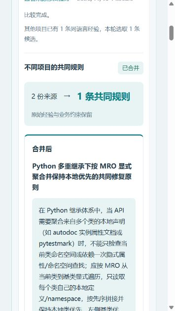

# pytest / Sphinx 正常项目修复与自动经验合并实录

本轮使用真实 DeepSeek 模型，通过产品的普通上传与任务接口执行。两项修复均通过独立最终验收；两条独立经验自动归纳为一条共同规则，并由模型独立复核通过。没有人工填写经验、复制参考补丁或强制批准合并。

[直接查看本次经验合并](http://127.0.0.1:5173/#/experiences?id=414bf457-a740-4d05-9760-772bd04e7616)。这是普通经验记录页，没有专用演示入口。

开始时间（UTC）：2026-11-15T06:09:26.548554+00:00
模型：deepseek-flash；服务：https://api.deepseek.com
配置来源：`D:\中级实训\self-evolving-coding-agent\.env`。未复制密钥。

两个任务使用单 Agent，各最多 70 轮决策；修复阶段任务时限临时设为 3600 秒，单次模型请求为 60 秒。Sphinx 提取重试阶段临时改为 180 秒单次请求上限。任务结束后恢复 600 秒任务时限、60 秒请求时限。`.env` 未修改，模型和密钥来源始终为上述项目文件。

## 输入与任务

| 项目 | 固定缺陷提交 | 上传项目 ID | 正常任务 ID |
|---|---|---|---|
| pytest | `3c1534944cbd34e8a41bc9e76818018fadefc9a1` | `upload-91b7d86d-b4ab-45d6-b020-abc9231a0be8` | `a85747f6-0acf-4670-9bb0-280d38298b19` |
| sphinx | `dd1615c59dc6fff633e27dbb3861f2d27e1fb976` | `upload-ac262de6-cd3e-4886-98a7-d400d9ab2db2` | `01403326-4f55-4098-887a-9136838899a1` |

## 可复核边界

- 源码 ZIP 的 SHA-256 与归档清单一致；上传文件数分别为 pytest 583、Sphinx 1421。
- 使用原始缺陷源码、上游回归测试和已公开的扩展验收；没有带入参考补丁或此前模型的修复文件。
- 普通 `/api/projects/upload` 导入源码，`/api/tasks` 执行修复。没有调用已移除的实验接口，也没有使用模型替身。
- 验收范围保留包中配置：pytest 302 项、Sphinx 148 项；每包已有一个明确排除的兼容性用例。最终实测数量以实际任务输出为准。
- 模型不共享两个任务的修复过程；各自按正常作用域检索经验。共同规则仅在原始经验成功保存后由产品后台归纳和复核。
- 未出现的冲突不会人为制造；若实际出现待审阅关系，处理依据、执行者与结果将在此记录。

## 实际运行结果

| 项目 | 修复前 | 中间失败数 | 独立最终验收 | 实际源码修改 |
|---|---|---|---|---|
| pytest | 302 项中 40 项失败 | 40 → 5 → 0 | 302/302 通过 | `src/_pytest/mark/structures.py` |
| Sphinx | 148 项中 10 项失败 | 10 → 10 → 16 → 10 → 1 → 0 | 148/148 通过 | `sphinx/ext/autodoc/__init__.py`、`sphinx/ext/autodoc/importer.py` |

这些数字是失败用例数量，不是独立缺陷数。验收覆盖所配置的相关子集，不代表两项目全部上游测试。pytest 排除 `testing/test_mark.py::TestKeywordSelection::test_keyword_extra_dash`；Sphinx 排除 `tests/test_ext_autodoc.py::test_cython`。最终运行均为 0 失败、0 错误、0 跳过。归档内生产代码由模型修改；验收文件、配置和其他归档文件逐项比对无变化，无缺失文件。

- [pytest 原任务](http://127.0.0.1:5173/#/tasks/a85747f6-0acf-4670-9bb0-280d38298b19)：20 轮决策，30 次工具调用，状态 `succeeded`；经验 `b6716e28-3f6f-409a-a462-17f008382321`，4 个问题。
- [Sphinx 原任务](http://127.0.0.1:5173/#/tasks/01403326-4f55-4098-887a-9136838899a1)：70 轮决策，85 次工具调用。因额度耗尽保留 `stopped`，但 `repair_succeeded=true`、`tests_passed=true`；恢复提取后经验为 `414bf457-a740-4d05-9760-772bd04e7616`，2 个问题。没有另建修复任务，也没有将停止记录改为成功。

## 自动合并前后

| 来源 | 独立业务问题 | 不能丢掉的条件 |
|---|---|---|
| pytest | 多重继承中的 `pytestmark` 收集漏掉其他基类，并存在子类复制父类标记产生重复/陈旧副本的问题 | 返回列表；`consider_mro=False` 仅查本地；不同父类的同名 marker 全部保留；`store_mark` 只写本地标记 |
| Sphinx | autodoc 未发现继承实例属性的注释；跨模块、菱形继承与显式截止类下输出不正确 | 本地/左侧父类优先；共同祖先成员只输出一次；不能覆盖已有文档；保留 `:inherited-members: <base>` 的截止语义 |

后台选择了 1 个跨项目候选对，未遗漏其他同语言候选。共同规则 ID 为 `c0fb0030-7b2a-5808-88e1-7816286f04f6`，标题为“Python 多重继承下按 MRO 显式聚合并保持本地优先的共同修复原则”。自动变化记录 ID 为 `a94ae79b-3e23-5623-b9f4-943daf817fcb`。

模型归纳出的共同机制：需要聚合多个基类的本地声明时，按 MRO/C3 显式遍历各类自身的定义或命名空间，保留继承顺序和当前类优先关系。具体同名条目的保留方式、截止类、参数开关与写入方式仍按各项目契约处理。独立模型复核为 `approved=true`，两个来源均 `supported=true`、`business_conditions_preserved=true`，`unsafe_generalizations=[]`。逐字引证、各源完整约束及两次独立最终验收（302、148 项）一同保存。

结果是 **2 份独立来源 → 1 条共同规则，2 份原始经验保留不变**。前后读取原始经验逐项相等。共同规则限定在正式项目修复命名空间，新目标仍须验证，不能将两个项目的完整补丁互换。

## 冲突处理的实际结果

本轮没有产生待处理冲突，未执行人工冲突决议。归纳与独立复核明确保留了潜在的业务差异：pytest 不按 marker 名去重，Sphinx 对同名属性保留高优先级文档；共同规则没有把这些操作统一成同一种去重策略。页面显示真实边界、复核理由及当前无待处理冲突的状态，不人为补造冲突用例。

## 运行中发现并修复的问题

1. **额度耗尽后丢失经验收尾**：Sphinx 第 85 步程序独立验收通过，但旧代码只允许 `succeeded` 状态提取经验。已修复自动收尾条件，并在正常任务页增加“重新提取经验”。恢复时核对历史快照、原始最终测试证据和项目身份；不重跑修复，不改写原任务步骤、时间或状态。具体实现与回归见修复文档 R36。
2. **大轨迹提取超过请求时限**：第一次提取收到 HTTP 200 后在读取响应体时发生 `ReadTimeout`，持续 60,778ms，记录为失败且未保存经验。完整轨迹约 405,941 字符。第二次显式重试将请求时限临时调到 180 秒，成功提取并正常触发自动合并。失败尝试保留；不能将本轮描述为一次请求全流程无故障完成。
3. **详情页先显示长原文，掩盖合并结果**：带经验 ID 的普通页面改为优先展示自动变化；完整原文、业务约束和引证可展开。窄屏先显示合并结论，桌面保留前后并列布局。

## 真实模型与验证记录

修复和提取的持久审计共 93 次请求：pytest 21 次成功；Sphinx 原修复 70 次成功、两次恢复提取中 1 次超时、1 次成功。成功响应模型名均为 `deepseek-flash`，身份均指向本项目 `.env` 和 `https://api.deepseek.com`，传输策略为 direct。两个修复任务均未检索或注入任何已有经验，独立产生知识后才比较。

成功修复/提取响应报告的 token 累计为 7,457,757；这不是完整账单，超时请求没有 usage，自动共同规则归纳/复核模块未持久化 token usage。模型持续读取文件使上下文累计较大，本轮不能用于证明成本优势。

产品修复回归：后端 **687 passed、1 skipped**；前端 **143 passed**；TypeScript 检查和生产构建通过。单元/集成回归使用测试替身；上表工程运行、经验内容及合并结论来自本次真实模型调用，两类证据严格区分。

原始运行清单、任务/步骤响应、恢复前状态、去除敏感信息的模型审计、原始经验快照、代码补丁、自动比较及复核结果保存在 `.cache/live-project-flow/20261115-normal-upload/`。本目录 `evidence/` 保存可复核结果副本。这里只执行了每个项目一个独立修复任务，属于一次端到端实跑，不能据此推断总体修复成功率或冲突检出率。

恢复服务默认时限并重启后，普通经验接口仍返回 `merged`，共同规则 ID、来源和复核结果保持一致；待处理冲突为 0。浏览器已打开上述经验链接，确认真实页面显示“2 份来源 → 1 条共同规则”、合并内容、原文引证及业务边界。

