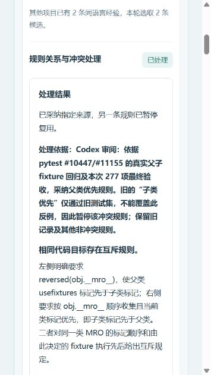

# pytest 真实回归：正常上传流程中的经验冲突

2026-11-15，使用项目 `.env` 的真实 DeepSeek 调用，完成普通 ZIP 上传、模型修复、独立验收、经验提取、自动冲突发现和正常页面审阅。没有向正式库植入模拟经验或预设冲突，也没有重跑旧 pytest/Sphinx 修复来凑结果。

[直接查看本次经验和处理记录](http://127.0.0.1:5173/#/experiences?id=9977f923-1736-4de7-ac0b-dea4a8e70001) · [本次修复任务](http://127.0.0.1:5173/#/tasks/b176ff8f-4044-4118-a666-150f62a77df2)

## 真实案例和关键冲突

[pytest #10447](https://github.com/pytest-dev/pytest/issues/10447) 是真实的 pytest 7.2 回归，由 [distutils #186](https://github.com/pypa/distutils/issues/186) 的工程测试失败暴露：子类 fixture 依赖父类 fixture 的初始化，但继承标记的顺序使子类先运行。上游通过 [pytest #11155](https://github.com/pytest-dev/pytest/pull/11155) 修正。

| 对比 | 先前真实修复经验 | 本次真实修复经验 |
|---|---|---|
| 目标 | `src/_pytest/mark/structures.py#get_unpacked_marks` | 同一代码符号 |
| 条件 | 类对象、`consider_mro=True`、继承标记聚合 | 同一条件，并覆盖父子 fixture 初始化依赖 |
| 措施 | 正向 `obj.__mro__`，当前/子类标记优先 | `reversed(obj.__mro__)`，父类标记优先 |
| 各自验收 | 旧任务 302 项通过 | 新任务 277 项通过 |
| 本次结果 | 暂停其中 1 条排序规则，其他 3 条保持有效 | 2 条新规则在审阅后恢复有效 |

这里不能把“两边都曾通过测试”当成没有冲突。旧测试集没有覆盖新出现的父子 fixture 依赖反例；宽泛的子类优先建议不能继续覆盖这个条件。原有历史验收仍然保留，没有改写成失败。

## 材料与正常运行过程

- 原始缺陷源码：`pytest-dev/pytest@b77d0deaf53697630ba534f62dc871f4eb275f14`。
- 原始回归测试来自上游测试提交 `561f1a993bcef74b626a43ec16c79a57b6aa99d9`，只替换 `testing/test_mark.py`。未将上游生产修复补丁加入上传包或模型提示。
- 通过官方 `setuptools_scm.dump_version` 生成 Git 归档缺失的构建版本模块，并准备 Python 3.10.20 独立环境和精确依赖清单。这些是上传前的构建准备，不计作模型修复。
- 登记测试：`testing/test_mark.py`、`testing/test_skipping.py`、`testing/python/collect.py`、`testing/python/fixtures.py::TestFixtureUsages`。明确排除既有预期失败 `TestKeywordSelection::test_keyword_extra_dash`；没有排除本次两个回归测试。
- 最初本地准备遇到旧实验环境 `.pth` 导入干扰和中文路径子进程编码问题，分别用新环境和继承 UTF-8 环境解决。正式上传的基线没有导入/收集错误，也没有跳过测试。
- ZIP SHA-256：`fec7fd1ee0bd012b3bb923aacfb7c48b4d79b882999dcb245a4e26e8e0e34c6b`，正常上传登记 580 个文件。
- 普通接口：`POST /api/projects/upload` → `POST /api/tasks`。上传项目为 `upload-3fe1e2c6-66ae-42b4-8113-6b3b15741e4b`。任务描述使用原始 issue 描述和通用修复要求，没有提示正确 MRO 方向。
- 修复任务：`b176ff8f-4044-4118-a666-150f62a77df2`，本地时间 17:38:41 开始，17:41:30 完成；14 轮模型决策、21 个工具步骤。
- 新经验：`9977f923-1736-4de7-ac0b-dea4a8e70001`。两个问题分别描述标记列表顺序和父子 fixture 初始化错误，引用同一次独立最终验收，不能将 277 项重复计算为两倍证据。

| 服务端实际执行 | 总数 | 通过 | 失败 | 错误 | 跳过 |
|---|---:|---:|---:|---:|---:|
| 原始缺陷基线，第 1 步 | 277 | 275 | 2 | 0 | 0 |
| 模型修改后，第 20 步 | 277 | 277 | 0 | 0 | 0 |
| 程序独立最终验收，第 21 步 | 277 | 277 | 0 | 0 | 0 |

失败测试是 `test_mark_mro` 和 `test_mark_fixture_order_mro`。模型只修改 `src/_pytest/mark/structures.py` 中的遍历方向；逐文件比对确认其余上传文件未改变，测试和配置没有被修改。见 [真实修复补丁](conflict-evidence/repair.diff)。

## 自动检测和实际处理结果

系统将新经验与已有的 pytest、Sphinx 两份 Python 经验比较。pytest 对具有 8 个共享精确代码符号的问题候选，模型找到 2 个互斥问题对，并经独立模型调用复核。两个关系都指向旧经验的第 4 条排序规则，不代表发现了两个独立工程缺陷。

1. 自动检测和独立复核后，保存双方原文、共同适用条件、互斥理由。两条新规则和旧排序规则暂停复用；旧 pytest/Sphinx 共同原则同步失去来源支持。
2. Codex 在普通经验页核对补丁及测试，选择新来源，并填写明确以 `Codex 审阅` 开头的依据。**冲突发现和独立复核是自动的，采纳哪条规则是本次有据可查的审阅决定，不冒充自动裁决。**
3. 决定 `21240400-cfb3-5043-8e9c-159bb016f5a3` 变为 `resolved`，版本 2，保留处理时间与历史。旧排序规则 `dd047c2e-5e0f-52a2-b568-6b026737698e` 暂停，旧经验另外三条保持有效；新经验两条规则恢复有效。
4. 另一关系 `62524b84-12ee-530d-9c60-a2fa9a395628` 因共享的旧规则已暂停，在正常查询中自动呈现 `obsolete`，不重复要求同一决定。其底层检测记录保留，没有伪造第二次裁决。
5. 原共享原则 `c0fb0030-7b2a-5808-88e1-7816286f04f6` 仍保留历史，但显示“合并已暂停”，不能继续以失去支持的旧排序规则指导复用。

| 观察项 | 检测前 | 待审阅 | 处理后 |
|---|---|---|---|
| 新经验有效规则 | 2 | 0 | 2 |
| 旧经验有效规则 | 4 | 3 | 3 |
| 新增冲突关系 | 0 | 2 条待处理 | 1 条已处理，1 条因同一旧规则停用而无需重复处理 |
| 旧 pytest/Sphinx 共同原则 | 可复用 | 暂停 | 继续暂停 |
| 原始经验内容 | 保留 | 不变 | 不变 |

Sphinx 比较是一个有意义的负对照：它处理文档的本地覆盖优先级，而新 pytest 规则处理父类初始化先后。真实模型拒绝将两者泛化成同一规则，两个项目的原始业务经验分别保留；没有为制造冲突而把不同业务要求视作同一合同。

待审阅时的普通页面：

处理后的普通页面：

## 调用来源、失败尝试和边界

全部调用来自 `D:\中级实训\self-evolving-coding-agent\.env`，`https://api.deepseek.com`，模型 `deepseek-flash`，直接连接。共 20 次模型请求：14 次修复决策、1 次提取、2 次冲突检测、2 次冲突复核、1 次 Sphinx 原则比较。供应商返回的总使用量为 233,012 tokens（包含重复上下文，不等同于独立事实数量或最终计费金额）。没有输出密钥。

首次检测已提出矛盾，但独立复核的问题编号集合不符合严格校验，未发布冲突。明确编号后，在普通经验页只重试失败的比较对；源码修复、经验提取、已完成的 Sphinx 比较均未重跑。首次 HTTP 请求成功不等于复核有效，失败尝试也计入上述请求数。原失败的错误编号响应未保存，报告不事后重建；后续已修复此审计缺口。

真实浏览器验收还发现旧前端误拒绝“单个来源的逐字引文”，已修复为按来源与问题索引验证真实子串。具体方案见 [R38–R40 修复记录](../../experience-consolidation-remediation.md)。

运行时请求上限临时调整为 180 秒、任务上限 3600 秒；完成后恢复 60 秒/600 秒，未改写 `.env`。服务重启后复核记录、暂停状态和原经验仍持久保留。

验证：后端全量 699 passed、1 skipped；编号/审计补充后的相关后端 35 passed；前端最终 144 passed，类型检查和生产构建通过，`git diff --check` 通过。单元测试中的受控响应仅存在于隔离测试数据库，不是本报告的效果数据。

这是一个真实反例及一个业务差异负对照，不是全库冲突识别准确率测量。跨上传检测仍受最多 5 个候选和精确共享符号限制；重命名/跨语言同义规则可能漏检，两次模型调用也可能犯相关错误。对于有明确不同版本合同的规则，应保留不同适用域，而不是无条件选择最新经验。本次只暂停未经新反例支持的宽泛排序规则，不否认旧版本的历史测试结果。

## 可核对证据

- [来源、任务和请求汇总](conflict-evidence/evidence-resolved.json)
- [真实模型调用审计](conflict-evidence/repair-audit-safe.json)
- [冲突前快照](conflict-evidence/snapshot-before.json)、[待审阅快照](conflict-evidence/snapshot-detected.json)、[处理后快照](conflict-evidence/snapshot-resolved.json)
- [真实检测/复核结果](conflict-evidence/comparison-pairs-resolved.json)、[失败尝试留档](conflict-evidence/comparison-attempts-resolved.json)
- [上游来源和上传配置](conflict-evidence/upload-manifest.json)、[测试步骤](conflict-evidence/steps.json)

原始上传包与完整运行材料保留在仓库 `.cache/live-project-flow/20261115-real-conflict/`；用户可在首页自行上传该 ZIP 再运行，产品没有专用案例入口。
