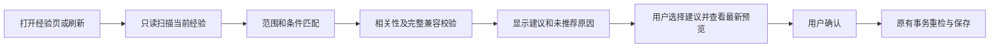

# 经验合并建议：方案与实现记录

用户选择“先只生成合并建议，仍手动确认”。本轮先完成详细设计、独立方案检查和实施计划，再增加只读建议接口及页面入口。没有运行自动合并或改写生产经验。

- [详细设计](../superpowers/specs/2026-11-14-merge-suggestions-design.md)
- [实施计划](../superpowers/plans/2026-11-14-merge-suggestions.md)
- [公共接口](../interfaces.md)

## 已实现流程

每条建议包含两条来源、共同规则或文件、合并后的问题数量和去重后的验证调用数。版本不同或未知会提示核对适用性。现有手工选择 2–10 条的功能保留，来源不删除；新功能没有模型调用费用或后台写入。

适用条件和能力集合采用精确比较，保留大小写和内部空白。规则、顺序、证据或内容容量冲突继续由原合并算法拒绝。自动发现只负责选择候选，不改写条件；关键词相似不能覆盖这些边界。

## 当前经验库只读验证

新服务实际扫描结果：

| 指标 | 结果 |
| --- | ---: |
| 扫描的当前记录 | 31 |
| 符合条件的有效 V3 候选 | 31（含 30 条项目经验、1 条通用经验） |
| 同语言、范围、仓库的配对 | 174 |
| 适用条件不同而拒绝 | 174 |
| 合并建议 | 0 |
| 结果截断 | 无 |
| 本次本地耗时 | 15.43 ms |

拒绝计数按适用条件、能力、相关性、完整兼容性顺序，每对只记第一个不满足条件的原因。因此这里的 174 不表示其余检查一定能通过。扫描前后主数据库及存在的 WAL/SHM 指纹一致，未生成合并记录。只读统计原件：`.cache/merge-suggestions/current-library.json`。单次耗时仅用于记录，不作为性能保证。

## 验证

- 建议服务与原有合并/发布相关测试：113 项通过。
- 新接口与原 V3 发布 API：10 项通过。
- 前端全量：135 项通过；TypeScript、生产构建通过；原接口联调 5 场景、66 公共模型对象通过。
- GitHub 上传前全量后端回归：666 passed、1 skipped（Windows 符号链接限制），包含新增的两项 WAL 边界用例；耗时 200.97 秒，有既有 Starlette/httpx 弃用提示。此前建议服务专项 22 项通过。
- 独立审查发现一项重要的规格过度承诺：SQLite `mode=ro` 仍可能维护 WAL/SHM 辅助文件。已将只读保证修正为经验内容及表结构不变，保留正常 WAL 已提交数据可见性，并补充相关验证。无其他阻塞发现。

SQLite 官方也明确说明，只读 WAL 库的读取可能依赖可读的现有辅助文件，或允许在目录中创建这些文件。该行为与本地复现一致，参见 [SQLite：只读数据库](https://www.sqlite.org/wal.html#read_only_databases)。

新增测试覆盖只读数据库指纹、缺失/旧库不创建升级、范围隔离、条件差异、互斥规则、顺序与证据冲突、扫描和结果上限、过期来源、旧响应丢弃，以及“预览不保存，确认才保存”。测试写入使用临时库；没有用真实模型调用验证新的修复效果。

实现时的测试反馈均保留在 `.cache/merge-suggestions/`：纯预览函数提取时遗漏局部冲突列表初始化，已定位并修复；旧前端测试按请求次序分配模拟响应，新增自动读取后改成按 URL 分配；新测试的一处 DOMWrapper 类型误用已在构建检查中修复。沙箱对 Vitest 临时缓存重命名和 FastAPI 本地异步通信有限制，相关测试使用允许正常本地操作的权限运行。

## 使用与限制

重启后端并刷新前端，进入“经验记录”。建议随筛选、合并或发布结果刷新，也可点击“刷新建议”。当前真实库应显示零建议和适用条件差异；点击某条建议只打开预览，用户确认后才会合并。

每次最多扫描最新 1000 条当前记录、分析其中 200 条合格经验，返回默认 10 组、最多 20 组，所有截断都会提示。候选和结果截断可通过筛选缩小；扫描范围本身受最新 1000 条限制。尚未实现自然语言语义等价判断，所以不同措辞但含义相同的条件也可能不被推荐。

新增 GET 不修改经验内容或表结构、不创建主数据库或迁移旧库；SQLite 在 WAL 模式下可能创建或维护辅助文件。当前库本次验证的全部已存在文件指纹不变，不能把该观测推广为所有 WAL 库的文件级不变保证。已有人工预览沿用兼容初始化连接，但不写合并经验；确认保存仍保留既有事务及相同来源集合幂等返回。该功能证明候选发现和人工确认流程可运行，不代表经验合并提高了真实修复成功率。
