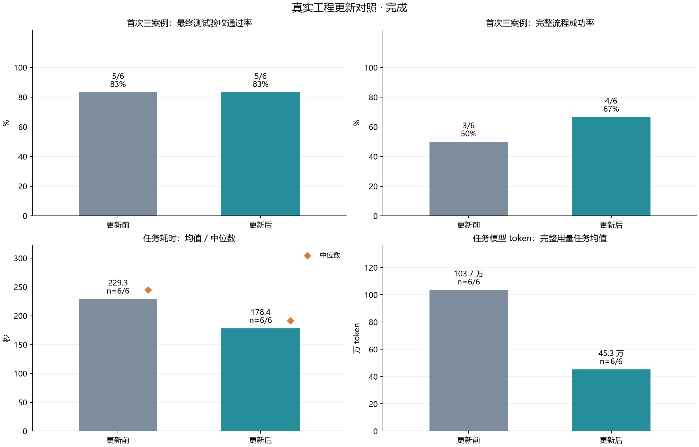
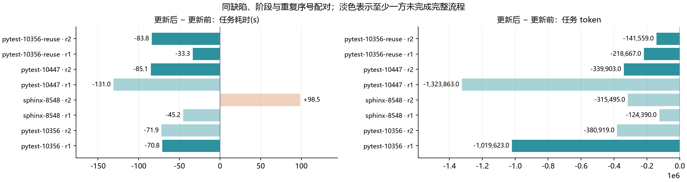
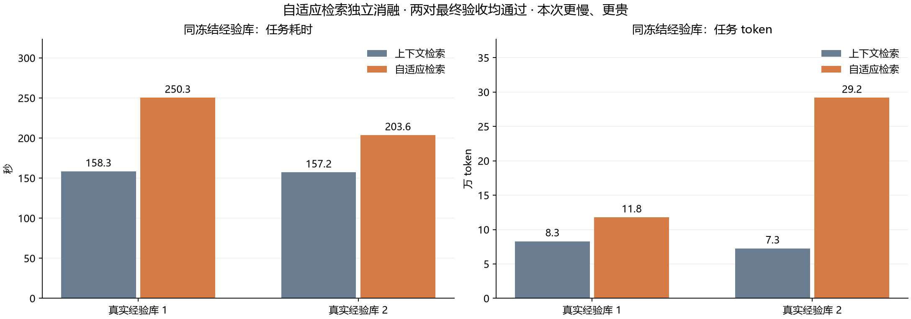
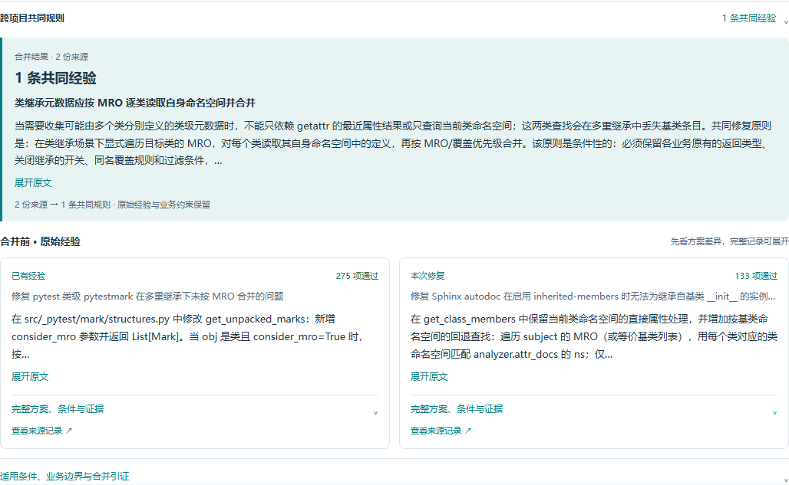
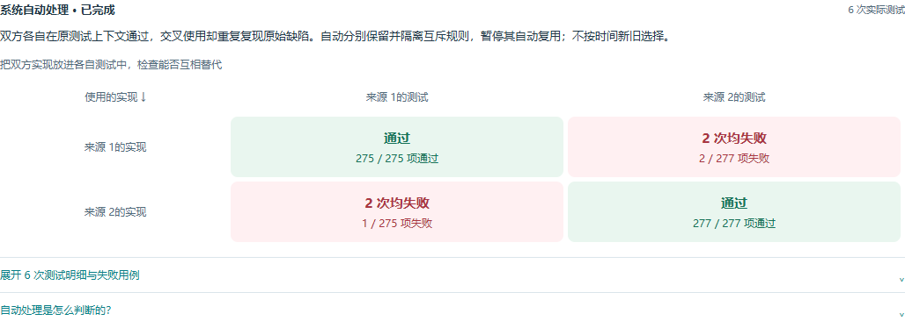

# 真实工程更新前后对比实验

状态：**已完成**。统计生成时间：2026-11-15T16:51:54.788582+00:00。

通过正常 ZIP 上传、运行环境配置和修复任务 API 执行真实模型调用。没有插入模拟经验或预设冲突；失败、停止和未完成任务全部保留。

[在正常项目任务页查看 12 次首次修复对比](http://127.0.0.1:5173/#/tasks/c8878919-c276-429f-89ef-0c561bc4cff7?compare=4339f2cc-79d4-4a9b-ae72-73ec864e5154,b1e243a0-8bd9-40b9-9934-d9e35942824b,7cca8258-685f-4409-8351-ce5e4edd56f8,35ee39ad-a773-4ffe-9a5c-4e162e95a526,0d51c7a7-642f-41f5-b243-37d335e75ec2,ca35c4eb-ca0e-47ee-aeb6-a08248bea7ac,39aff23b-7c4f-4a2f-89b5-dc824c57373a,f391fd5e-eacd-4488-b573-ec5ac498a18f,41b474fd-b443-4508-8ed9-9bca90a456f7,60d9c732-175f-4337-9151-3ff5e8cb4826,8a4b87b6-6ce8-49ec-9946-2947d48bd474,e1de3efe-715c-4655-8565-860c5b9ceb90)。入口为主应用 `5173` 的普通任务页；承载页面的已有任务仅作导航容器，不计入选中的 12 次实验或统计分母。

## 实际结果概览

前三个真实缺陷、每版两轮：最终测试验收 **5/6 → 5/6**，完整流程成功 **3/6 → 4/6**，已保存经验 **3 → 5**。
任务耗时均值 **229.3s → 178.4s**；任务 token 总计 **6,219,888 → 2,715,695**。包含全部终止任务，后台用量另列。
整体更新成本变化不能直接归因于自适应检索；下文同时列出双方验收通过的配对，以排除提前失败造成的低成本。

同冻结库检索消融有 **2 对双方验收通过**的运行：自适应相对上下文检索平均耗时差 **69.2s**、token 差 **126,998**。正值表示自适应更慢、更贵；本次实验没有证明自适应节省成本。

## 对照范围

更新前 `d724266`，更新后 `4ed926a`。
仅 **3 个独立工程缺陷**。每版本两条独立经验累积序列，后续再次修复同一缺陷属于复用试验，不能当成新工程样本。

计划为主实验 16 次，加同冻结库检索消融 4 次，共 20 次；当前已有 20 条计划/执行记录，尚未登记的计划不计成成功或失败。

原版本没有 ZIP 导入，使用共同的上传、物理 ToolService、运行环境及观测适配层；旧版核心仍向模型提供 5 个工具，新版核心提供 7 个工具。旧版修复、检索和经验处理逻辑保留。当前版通过普通流程自动处理经验。两组使用同一来源归档、公开回归测试、模型与决策预算。工具菜单、提示词和提取变化属于整体更新效应，不能单独归因于检索。

每条序列的第一次 pytest 修复从空经验库开始，两版本均没有历史参考经验；这轮出现的 token 差异不能解释为自适应检索节省。后续 Sphinx 和 pytest 回归任务按序累积真实经验。第四阶段再次修复 pytest 位于冲突处理阶段之后，单列为冲突后复修，不与前三个首次任务混为独立样本。

| 真实缺陷 | 原始测试 | 原始失败 | 测试范围 |
|---|---:|---:|---|
| [pytest-10356](https://github.com/pytest-dev/pytest/issues/7792) | 275 | 1 | 完整登记上游模块；非全仓库测试 |
| [sphinx-8548](https://github.com/sphinx-doc/sphinx/issues/741) | 133 | 1 | 完整登记上游模块；非全仓库测试 |
| [pytest-10447](https://github.com/pytest-dev/pytest/issues/10447) | 277 | 2 | 完整登记上游模块；非全仓库测试 |

测试集合中的既有无关预期失败和可选 Cython 用例按清单明确排除，两组相同。未向模型提供上游生产修复补丁。

## 修复结果

分开统计两种结果：**最终测试验收通过**要求程序独立测试数量匹配且无失败、异常、跳过，与任务是否耗尽决策预算无关；**完整流程成功**保持预注册条件，要求任务 succeeded 且修复/测试标记通过。任务 stopped 但最终测试全通过，记作补丁验收通过、流程未完成。经验是否保存另列。两个通过率的分母均为已终止任务；缺少最终证据与未完成任务不会称为测试失败。

| 阶段 / 版本 | 计划 / 提交 / 终止 | 最终验收通过 / 终止 | 验收通过率 | 完整流程成功 / 终止 | 流程成功率 | 未完成 | 任务耗时均值 / 中位数(s) | 平均 token / 用量完整任务 |
|---|---:|---:|---:|---:|---:|---:|---:|---:|
| 首次三案例 / 更新前 | 6 / 6 / 6 | 5 / 6 | 83.3% | 3 / 6 | 50.0% | 0 | 229.3 / 245.1 | 1,036,648 / 6 of 6 |
| 首次三案例 / 更新后 | 6 / 6 / 6 | 5 / 6 | 83.3% | 4 / 6 | 66.7% | 0 | 178.4 / 191.6 | 452,615.8 / 6 of 6 |
| 冲突后复修 / 更新前 | 2 / 2 / 2 | 2 / 2 | 100.0% | 2 / 2 | 100.0% | 0 | 187.4 / 187.4 | 318,473.5 / 2 of 2 |
| 冲突后复修 / 更新后 | 2 / 2 / 2 | 2 / 2 | 100.0% | 2 / 2 | 100.0% | 0 | 128.8 / 128.8 | 138,360.5 / 2 of 2 |
| 同冻结库检索消融 / 上下文检索 | 2 / 2 / 2 | 2 / 2 | 100.0% | 2 / 2 | 100.0% | 0 | 157.7 / 157.7 | 77,773.5 / 2 of 2 |
| 同冻结库检索消融 / 自适应检索 | 2 / 2 / 2 | 2 / 2 | 100.0% | 2 / 2 | 100.0% | 0 | 226.9 / 226.9 | 204,771.5 / 2 of 2 |

均值和中位数包含失败/停止的终止任务；token 平均值仅基于用量完整任务，覆盖不足时不能代表整组真实成本。任务耗时含经验提取，不含后续后台比较。

## 同任务配对

差值为后者减前者。更新对照按缺陷、阶段、重复序号配对；检索消融还要求冻结经验库指纹完全相同。三种成本口径并列：全部已终止任务、双方最终测试验收通过、双方完整流程成功。验收通过子集包含预算耗尽但补丁有效的任务，排除一方最终未修好的配对；新增口径不改变预注册完整流程条件。

| 对照 / 计入条件 | 有效配对 | 耗时均值差(s) / 完整配对 | token均值差 / 完整配对 |
|---|---:|---:|---:|
| 主实验全部：更新前 → 更新后 / 全部已终止 | 8 | -52.8 / 8 | -483,052.4 / 8 |
| 主实验全部：更新前 → 更新后 / 双方最终验收通过 | 6 | -41.1 / 6 | -402,694.3 / 6 |
| 主实验全部：更新前 → 更新后 / 双方完整流程成功 | 4 | -68.2 / 4 | -429,938 / 4 |
| 首次三案例：更新前 → 更新后 / 全部已终止 | 6 | -50.9 / 6 | -584,032.2 / 6 |
| 首次三案例：更新前 → 更新后 / 双方最终验收通过 | 4 | -32.3 / 4 | -513,985 / 4 |
| 首次三案例：更新前 → 更新后 / 双方完整流程成功 | 2 | -77.9 / 2 | -679,763 / 2 |
| 冲突后复修：更新前 → 更新后 / 全部已终止 | 2 | -58.6 / 2 | -180,113 / 2 |
| 冲突后复修：更新前 → 更新后 / 双方最终验收通过 | 2 | -58.6 / 2 | -180,113 / 2 |
| 冲突后复修：更新前 → 更新后 / 双方完整流程成功 | 2 | -58.6 / 2 | -180,113 / 2 |
| 同冻结库检索消融：上下文检索 → 自适应检索 / 全部已终止 | 2 | 69.2 / 2 | 126,998 / 2 |
| 同冻结库检索消融：上下文检索 → 自适应检索 / 双方最终验收通过 | 2 | 69.2 / 2 | 126,998 / 2 |
| 同冻结库检索消融：上下文检索 → 自适应检索 / 双方完整流程成功 | 2 | 69.2 / 2 | 126,998 / 2 |

## 模型来源与已经发生的用量

本次唯一配置文件：`D:\中级实训\self-evolving-coding-agent\.env`；服务源站 `https://api.deepseek.com`，请求模型 `deepseek-flash`。已封存 377 个实际响应，377 个均上报 usage；配置不符数量 0。
证据层级区分：194 个请求有逐请求 api_configuration；183 个旧版请求仅有旧 worker 的任务级项目配置、未改动内核，以及逐请求 requested/returned model 与 direct transport。旧版缺少逐请求配置字段，不补造该字段，也不因此误判 API 不符。
当前已经发生并上报的 token 为 **10,472,460**，包含任务 10,414,341 和 7 次后台调用。等待用户确认后可能发生的未来用量尚不存在，不计入这个封存小计；等待状态的完整生命周期成本仍保持未知。

## 后台经验处理用量

后台归纳、独立复核和冲突发现的模型用量单列。交叉运行真实测试的时间不等于额外模型 token。未记录不填成零。token 为服务返回的用量，不等于货币账单；缓存命中等计费因素未据此估算。

| 版本 | 后台 token 总计 | 已上报 token 小计（下界） | 用量完整任务 / 终止任务 | 后台耗时均值(s) |
|---|---:|---:|---:|---:|
| 更新前 | 0 | 0 | 8 / 8 | — |
| 更新后 | — | 58,119 | 6 / 8 | 44.1 |
| 上下文检索 | 0 | 0 | 2 / 2 | 1.8 |
| 自适应检索 | 0 | 0 | 2 / 2 | 1.3 |

指标修正保留原快照：after1-sphinx-8548。任务结果与数据库共同确认未生成经验、未启动后台工作，因此后台为实际不适用的 0；不是把未知用量补零。原 metrics_initial_snapshot 与当前读数均保留。

## 自适应检索的独立对照

各对使用同一真实首次修复生成的冻结经验库，库指纹一致；全部任务仍走普通上传/修复 API。每个条件只有两次运行。

| 条件 / 轮次 | 最终验收 | 耗时(s) | 任务 token | 实际携带经验的模型请求 | 撤下经验事件 tests_passed |
|---|---|---:|---:|---:|---:|
| 上下文检索 / 1 | 通过 | 158.3 | 82,981 | 5 | 0 |
| 自适应检索 / 1 | 通过 | 250.3 | 117,784 | 5 | 1 |
| 自适应检索 / 2 | 通过 | 203.6 | 291,759 | 18 | 2 |
| 上下文检索 / 2 | 通过 | 157.2 | 72,566 | 6 | 0 |

自适应确实会按测试阶段撤下经验；请求总数与修复轨迹也随模型决策变化，撤下机制生效不等于总 token 必然下降。本次两个配对均观察到自适应更慢、更贵，不能宣传为性能提升。

## 经验处理前后

下表来自实际任务前后快照。原始经验仍保留，共同原则增加不意味着删除来源。规则数是存储的规则记录数，不等于全部已获准复用。

| 运行 | 原始记录 | 规则记录 | 共同原则 | 冲突关系 | 后台状态 |
|---|---:|---:|---:|---:|---|
| before1-pytest-10356 | 0 → 1 | 0 → 0 | 0 → 0 | 0 → 0 | not_supported |
| after1-pytest-10356 | 0 → 1 | 0 → 3 | 0 → 0 | 0 → 0 | succeeded |
| after2-pytest-10356 | 0 → 1 | 0 → 2 | 0 → 0 | 0 → 0 | succeeded |
| before2-pytest-10356 | 0 → 0 | 0 → 0 | 0 → 0 | 0 → 0 | not_supported |
| before1-sphinx-8548 | 1 → 2 | 0 → 0 | 0 → 0 | 0 → 0 | not_supported |
| after1-sphinx-8548 | 1 → 1 | 3 → 3 | 0 → 0 | 0 → 0 | not_applicable |
| after2-sphinx-8548 | 1 → 2 | 2 → 3 | 0 → 1 | 0 → 0 | succeeded |
| before2-sphinx-8548 | 0 → 0 | 0 → 0 | 0 → 0 | 0 → 0 | not_supported |
| before1-pytest-10447 | 2 → 2 | 0 → 0 | 0 → 0 | 0 → 0 | not_supported |
| after1-pytest-10447 | 1 → 2 | 3 → 5 | 0 → 0 | 0 → 2 | succeeded |
| after2-pytest-10447 | 2 → 3 | 3 → 4 | 1 → 1 | 0 → 1 | waiting |
| before2-pytest-10447 | 0 → 1 | 0 → 0 | 0 → 0 | 0 → 0 | not_supported |
| before1-pytest-10356-reuse | 2 → 3 | 0 → 0 | 0 → 0 | 0 → 0 | not_supported |
| after1-pytest-10356-reuse | 2 → 3 | 5 → 8 | 0 → 0 | 2 → 2 | succeeded |
| after2-pytest-10356-reuse | 3 → 4 | 4 → 7 | 1 → 1 | 1 → 1 | waiting |
| before2-pytest-10356-reuse | 1 → 2 | 0 → 0 | 0 → 0 | 0 → 0 | not_supported |
| contextual1 | 1 → 2 | 3 → 6 | 0 → 0 | 0 → 0 | succeeded |
| adaptive1 | 1 → 2 | 3 → 6 | 0 → 0 | 0 → 0 | succeeded |
| adaptive2 | 1 → 2 | 2 → 4 | 0 → 0 | 0 → 0 | succeeded |
| contextual2 | 1 → 2 | 2 → 5 | 0 → 0 | 0 → 0 | succeeded |

- 冲突 `ac930ac3-7a94-53a7-84c7-67fe8e09805c`：执行者 `system`，状态 `resolved`，处理 `keep_separate`。双方各自在原测试上下文通过，交叉使用却重复复现原始缺陷。自动分别保留并隔离互斥规则，暂停其自动复用；不按时间新旧选择。

  | 实现来源 → 测试来源 | 轮次 | 结果 | 失败 / 测试数 | 原始失败重现 |
  |---|---:|---|---:|---|
  | `e335294b` → `e335294b` | 1 | passed | 0 / 275 | False |
  | `111b311c` → `111b311c` | 1 | passed | 0 / 277 | False |
  | `111b311c` → `e335294b` | 1 | failed | 1 / 275 | True |
  | `111b311c` → `e335294b` | 2 | failed | 1 / 275 | True |
  | `e335294b` → `111b311c` | 1 | failed | 2 / 277 | True |
  | `e335294b` → `111b311c` | 2 | failed | 2 / 277 | True |

- 冲突 `7ba80add-6f0d-5723-b8f0-081a2c681dd4`：执行者 `system`，状态 `needs_confirmation`，处理 `None`。证据不足，保留双方并交由用户确认。函数调用接口或装饰器不同，不能可靠移植。

- 冲突 `d3fd3b49-b538-47aa-a4e4-8e1305eba9e3`：执行者 `system`，状态 `needs_confirmation`，处理 `None`。证据不足，保留双方并交由用户确认。快照、执行条件或审阅状态未通过校验。

- 冲突 `da95468f-94fb-4c12-a3cf-716d8f4c6af2`：执行者 `system`，状态 `needs_confirmation`，处理 `None`。证据不足，保留双方并交由用户确认。快照、执行条件或审阅状态未通过校验。

- 冲突 `025826b8-f513-4b6b-95fc-fbb6eaffbae5`：执行者 `system`，状态 `needs_confirmation`，处理 `None`。证据不足，保留双方并交由用户确认。快照、执行条件或审阅状态未通过校验。

- 冲突 `efb63932-a79f-4b56-8087-0e0d545ab359`：执行者 `system`，状态 `needs_confirmation`，处理 `None`。证据不足，保留双方并交由用户确认。快照、执行条件或审阅状态未通过校验。

- 冲突 `17d22c36-d99c-45c3-96ec-868af1d0d8da`：执行者 `system`，状态 `needs_confirmation`，处理 `None`。证据不足，保留双方并交由用户确认。快照、执行条件或审阅状态未通过校验。

- 冲突 `7f8e317e-9294-4e72-be75-30a7b087abbc`：执行者 `system`，状态 `needs_confirmation`，处理 `None`。证据不足，保留双方并交由用户确认。快照、执行条件或审阅状态未通过校验。

## 同轮次经验生命周期

第 2 轮的 pytest 标记继承和 Sphinx 实例属性文档来自两个独立修复任务。系统将“继承链元数据需要逐类读取自身定义再按业务规则合并”归纳为共同原则，保留原始两条经验及各自参数。随后 pytest 版本冲突使该原则失效并暂停复用。第 1 轮自动隔离矩阵属于另一条独立序列，不能拿来充当第 2 轮已完成处理的证据。

| 序列 / 阶段 | 记录 | 前后状态 | 原因 |
|---|---|---|---|
| after2 / before_conflict | 88e69a36-a000-5bd9-b922-56314d1bb08a | merged | 两源均支持该有条件原则：它们同属类继承链上类级元数据查询遗漏基类条目的因果模式，修复动作均为显式按 MRO 读取各类自身命名空间定义后合并。候选未把 pytest 的累积/返回类型/开关与 Sphinx 的键结构/同名覆盖/inherited-members 过滤互相迁移；pytest 的生成器物化仅作为该源业务参数保留，Sphinx 的输出格式也未外推。故通过。 |
| after2 / after_conflict | 88e69a36-a000-5bd9-b922-56314d1bb08a | invalidated | 来源已变更、停用或有待审阅规则；历史合并当前不可复用。 |
| after1 / automatic_conflict | 3b168bbb-40f2-560e-958c-780fbecb94be | obsolete | 左项要求父类 usefixtures 先于子类执行，为此必须反向遍历 MRO；右项使用正向 obj.__mro__，会把子类 C 的标记排在父类 A/B 之前。在同一父类-子类继承场景中，两者规定的夹具执行先后相反，不能同时成立。 |
| after1 / automatic_conflict | ac930ac3-7a94-53a7-84c7-67fe8e09805c | resolved | 左项要求反向 MRO，先基类后派生类；右项要求按 obj.__mro__ 正向收集并明确给出 C(A, B) 的 [C,A,B] 顺序。对同一个多重继承类对象，二者不能同时满足，属于互斥的标记顺序规定。 |
| after2 / insufficient_evidence | 7ba80add-6f0d-5723-b8f0-081a2c681dd4 | pending | 左侧要求按 obj.__mro__ 正序累积并保证 C、A、B 顺序，即派生类标记先于基类；右侧要求对 obj.__mro__ 反向遍历，使最基类标记先返回、派生类标记后返回。两者作用于同一函数的同一 consider_mro=True 分支，对同一多重继承场景规定了互斥的标记顺序，无法同时满足。 |
| after2 / insufficient_evidence | cf5c3d92-804a-524d-a92f-c2541cc0836b | rejected | 源1的根因是命名空间键不匹配（Foo vs Bar）导致基类实例属性注释未被发现，修复需基类回退且派生类优先；源2的根因是 MRO 正向遍历导致派生类标记先于基类，修复需反向遍历。两者的优先级方向相反，且过滤/记录 class_ 与 consider_mro=False 等约束互不适用，故不构成同一具体因果修复原则。 |

第 1 轮：原上下文分别 275/275、277/277 通过；两向交叉各重复两次，分别重现 1/275 与 2/277 失败，系统自动 keep_separate。第 2 轮：函数接口或装饰器差异使可靠移植不成立，交叉执行次数为 0，保留双方并等待用户确认；没有人工替系统挑选胜者。

## 逐任务结果

| 运行 | 任务状态 | 最终测试验收 | 完整流程 / 经验保存 | 耗时(s) | 任务token | 注入请求 | 后台token |
|---|---|---|---|---:|---:|---:|---:|
| [before1-pytest-10356](http://127.0.0.1:5181/#/tasks/b1e243a0-8bd9-40b9-9934-d9e35942824b) | succeeded | 通过 | 成功 / 已保存 | 279.4 | 1,286,973 | 0 | 0 |
| [after1-pytest-10356](http://127.0.0.1:5182/#/tasks/7cca8258-685f-4409-8351-ce5e4edd56f8) | succeeded | 通过 | 成功 / 已保存 | 208.6 | 267,350 | 0 | 0 |
| [after2-pytest-10356](http://127.0.0.1:5184/#/tasks/35ee39ad-a773-4ffe-9a5c-4e162e95a526) | succeeded | 通过 | 成功 / 已保存 | 177.7 | 552,441 | 0 | 0 |
| [before2-pytest-10356](http://127.0.0.1:5183/#/tasks/0d51c7a7-642f-41f5-b243-37d335e75ec2) | stopped | 通过 | 未完成 / 未保存 | 249.6 | 933,360 | 0 | 0 |
| [before1-sphinx-8548](http://127.0.0.1:5181/#/tasks/ca35c4eb-ca0e-47ee-aeb6-a08248bea7ac) | succeeded | 通过 | 成功 / 已保存 | 250.7 | 953,334 | 0 | 0 |
| [after1-sphinx-8548](http://127.0.0.1:5182/#/tasks/39aff23b-7c4f-4a2f-89b5-dc824c57373a) | stopped | 未通过 | 未完成 / 未保存 | 205.5 | 828,944 | 0 | 0 |
| [after2-sphinx-8548](http://127.0.0.1:5184/#/tasks/f391fd5e-eacd-4488-b573-ec5ac498a18f) | stopped | 通过 | 未完成 / 已保存 | 275.1 | 963,915 | 0 | 20,409 |
| [before2-sphinx-8548](http://127.0.0.1:5183/#/tasks/41b474fd-b443-4508-8ed9-9bca90a456f7) | stopped | 通过 | 未完成 / 未保存 | 176.5 | 1,279,410 | 0 | 0 |
| [before1-pytest-10447](http://127.0.0.1:5181/#/tasks/60d9c732-175f-4337-9151-3ff5e8cb4826) | stopped | 测试无法启动 | 未完成 / 未保存 | 240.6 | 1,385,772 | 0 | 0 |
| [after1-pytest-10447](http://127.0.0.1:5182/#/tasks/8a4b87b6-6ce8-49ec-9946-2947d48bd474) | succeeded | 通过 | 成功 / 已保存 | 109.6 | 61,909 | 0 | 20,379 |
| [after2-pytest-10447](http://127.0.0.1:5184/#/tasks/4339f2cc-79d4-4a9b-ae72-73ec864e5154) | succeeded | 通过 | 成功 / 已保存 | 93.8 | 41,136 | 0 | — |
| [before2-pytest-10447](http://127.0.0.1:5183/#/tasks/e1de3efe-715c-4655-8565-860c5b9ceb90) | succeeded | 通过 | 成功 / 已保存 | 178.9 | 381,039 | 0 | 0 |
| [before1-pytest-10356-reuse](http://127.0.0.1:5181/#/tasks/f6328ee4-e9c7-49c5-9179-01972c25da56) | succeeded | 通过 | 成功 / 已保存 | 162.4 | 323,175 | 13 | 0 |
| [after1-pytest-10356-reuse](http://127.0.0.1:5182/#/tasks/c82d766f-555b-41f8-8c71-469583182ad0) | succeeded | 通过 | 成功 / 已保存 | 129.1 | 104,508 | 5 | 0 |
| [after2-pytest-10356-reuse](http://127.0.0.1:5184/#/tasks/5498c6a1-9b86-4aa2-b8c5-d37eb4692272) | succeeded | 通过 | 成功 / 已保存 | 128.5 | 172,213 | 11 | — |
| [before2-pytest-10356-reuse](http://127.0.0.1:5183/#/tasks/b6083016-fa48-4760-a3f1-20a4b2a0b676) | succeeded | 通过 | 成功 / 已保存 | 212.3 | 313,772 | 0 | 0 |
| [contextual1](http://127.0.0.1:5185/#/tasks/b6e8a5c5-4d92-4189-bf09-9f0fad0b2d90) | succeeded | 通过 | 成功 / 已保存 | 158.3 | 82,981 | 5 | 0 |
| [adaptive1](http://127.0.0.1:5186/#/tasks/b81bdd06-3f11-40eb-b438-d176be2641c6) | succeeded | 通过 | 成功 / 已保存 | 250.3 | 117,784 | 5 | 0 |
| [adaptive2](http://127.0.0.1:5188/#/tasks/b6242777-c6c0-493a-9bdd-5cfa1516d3f2) | succeeded | 通过 | 成功 / 已保存 | 203.6 | 291,759 | 18 | 0 |
| [contextual2](http://127.0.0.1:5187/#/tasks/4ad7c328-1a93-4e34-aef6-e889ce0921cb) | succeeded | 通过 | 成功 / 已保存 | 157.2 | 72,566 | 6 | 0 |

- `before2-pytest-10356`：决策次数已用完。独立最终测试实际通过，不能称为测试失败。没有生成经验记录。

- `after1-sphinx-8548`：决策次数已用完。没有生成经验记录。

- `after2-sphinx-8548`：决策次数已用完。独立最终测试实际通过，不能称为测试失败。

- `before2-sphinx-8548`：决策次数已用完。独立最终测试实际通过，不能称为测试失败。没有生成经验记录。

- `before1-pytest-10447`：决策次数已用完。没有生成经验记录。
  模型生成的生产补丁含 `PLACEHOLDER`，最终测试启动即 `NameError`，测试数为 0、退出码为 1。不是 277 项测试全部失败；这是生成了无效补丁。

## 测试与 fixture 完整性

最终只读字节核查状态：`verified`；核对 20 个任务工作副本，20 个与上传清单的测试摘要及文件数完全一致。
先按原始 manifest 的 inventory 过滤匹配摘要及文件数，再独立遍历 tests/、testing/ 下测试和 fixture，补核原摘要目录剪枝可能漏掉的 target 等测试资源。缓存按原规则排除。运行中的任务不扫描；最终阶段才读取工作区，避免影响正式计时。

## 实际观测图

## 普通经验记录页的真实前后态

第 2 轮：pytest 与 Sphinx 独立经验自动归纳共同原则；冲突发生前

同一第 2 轮：后续冲突使上述共同原则 invalidated，暂停复用

第 1 轮：双方各自通过，四次交叉测试复现原始失败，系统自动隔离

第 2 轮：函数接口无法可靠移植，交叉测试未运行，交用户确认

## 发现的不足与补充验证

本次冻结版本存在规则过滤后的共享约束泄漏：暂停的 MRO 规则 ID 未直接注入，但同一来源的可用列表规则仍携带完整 source.constraints，把已暂停的 [C,A,B] 顺序带回模型上下文。历史请求审计发现 5 次携带，单项与列表双哈希核对当时实际渲染的参考内容。因此“规则 ID 已隔离”不能等同于“冲突语义已彻底隔离”。该证据证明引用进入真实请求，不能证明模型内部采纳或对修复结果的因果影响。
20 次原实验完整保留，期间没有更换核心修复上述问题。补丁和第 21 次真实安全回归单列为后续补充；当前补充状态：已完成，独立补充记录。补充未运行不会记成失败或成功，也不会混入原 20 次统计。
补充回归从当时真实 after1 数据库备份启动，不手改经验或暂停记录。该库后来新增 unknown 关系已阻断先前来源，因此补充运行仅能证明当前流程是否注入错误约束及修复是否通过，不能冒充重现旧前态或证明受控的补丁效果。

已保存独立约束泄漏审计；详见统计 JSON 的 shared_constraint_leak_audit，保留历史任务/请求与双哈希证据。

## 附录：第 21 次补充安全回归

这是使用修复后实现与后来真实演化经验库的一次补充运行。它没有对原 20 次实验重跑或替换结果，不进入上面的成功率、均值、配对和图。原始历史泄漏证据仍保留。

| 任务 | 状态 | 最终测试验收 | 完整流程 | 经验保存 | 耗时(s) | 任务 token | 携带经验的成功请求 | 后台状态 |
|---|---|---|---|---|---:|---:|---:|---|
| [bf53e089-ba3a-4965-b5b8-5c42c47544c0](http://127.0.0.1:5189/#/tasks/bf53e089-ba3a-4965-b5b8-5c42c47544c0) | succeeded | 通过（275 项） | 成功 | 已保存 | 158.6 | 63,104 | 0 | succeeded |

本次原始经验记录 **3 → 4**；后台实际模型调用 0 次、耗时 2.3s。涉及审阅关系 18 条，包含历史 unknown 等关系，不能解释为新产生同样数量的冲突。

种子备份 SHA-256：`5d001e09850079eea5742d1a59af21ba3721f6810ed093b6e2edc90fc145ab2a`；代码 HEAD：`4ed926a33dd5c2d923852ae482136857fbaf7bd8`。实际实现以逐文件 SHA-256 为准，未提交修复也由内容指纹区别。

- `backend/experience/knowledge.py`：`6b3295c8898045d8aba49063ad6d1a11d2a793314bb2b206aab01b7ef2918865`
- `backend/experience/library.py`：`2dd9026b2b26f6386fa183dd11357eac2ee643f37db9c6006e81cda82dad6139`

补充测试/fixture 独立核查：`verified`，1/1 个工作副本一致；不并入原 20/20 核查数量。
安全结论须结合实际请求引用审计；最终测试通过本身不能证明所有冲突语义均未泄漏。已记录独立请求审计，见统计 JSON 的 supplemental_safety.request_safety_audit。
这份种子已有后续 unknown 关系阻断旧来源，不能把本次当成旧泄漏前态的受控重放；补充结果仅说明当前流程的实际运行情况。

独立请求审计确认 **7/7 次真实供应商响应**，完整上报 **63,104 tokens**；全部请求匹配本项目配置：`True`。
请求引用 ID/摘要检查：全部为空；注入事件检查：全部符合空引用列表摘要；历史泄漏单项/列表摘要：未命中 / 未命中。这支持本次实际未发送经验引用，不能单凭这一运行归因证明补丁消除了所有历史旁路。

补丁涵盖共享约束与等价链阻断、限定授权边界、恢复状态解释，以及一次请求内复用资格校验结果。验证版本边界：等价隔离版完整后端为 **999 passed、1 skipped**；随后加入的请求内校验复用另经 **45 项相关检查及 11 项 API/正常上传归并检查**通过，不能将前述全量结果归为之后的性能优化版本。详见 [R70–R73 修复记录](../experience-consolidation-remediation.md)。

## 解释边界

这是小样本工程验证，不代表所有项目的平均成功率。重复修复不是独立缺陷；不能把整体更新造成的变化全部归因于自适应检索。检索消融必须同模型、同任务和同冻结经验库；缺少实际注入时必须说明。未完成的运行不会被当作失败或成功。

修复成功率、延迟、token 和后台处理必须同时看；更低用量可能来自提前失败。现有少量配对不用于宣称统计显著性。图表仅来自终止任务的真实数据，尚无数据的组不画零值。
